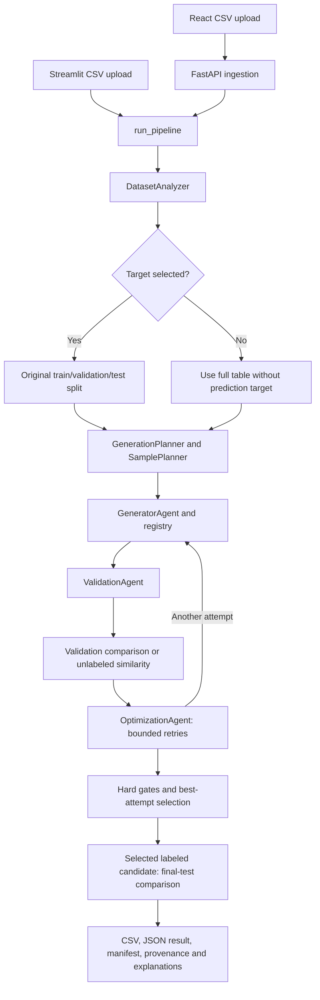

# Current architecture

Updated for Milestones 3–9 on 2026-10-31, extending baseline commit `6c31cdf`. The platform now includes optional isolated tabular/temporal research workers, durable experiment tracking, and a local text-consistency baseline. See [IMPLEMENTATION_STATUS.md](IMPLEMENTATION_STATUS.md) and [MILESTONES.md](MILESTONES.md) for measured verification and boundaries.

## Runtime and entry points

The application is a single-machine Python pipeline with cooperating agent classes. These are ordinary deterministic components, with an optional Gemini explanation layer; they are not independently deployed agents.

| Area | Entry point / responsibility |
| --- | --- |
| Backend | `python run.py --reload` starts `app.api.main:app` using Uvicorn/FastAPI |
| React frontend | `frontend/src/main.tsx` mounts `App.tsx`; Vite, TypeScript, Tailwind, Recharts, Lucide |
| React development proxy | `frontend/vite.config.ts`: port 5173, `/api` forwarded to port 8000 |
| Streamlit frontend | `frontend/dashboard.py` calls `run_pipeline` directly in its own Python process |
| Configuration | `app/config.py`: Pydantic settings from defaults, `.env`, and environment variables |
| Public data structures | `app/schemas/schemas.py`: Pydantic analysis, plans, metrics, iteration records, results |
| Deployment | Python 3.12 Dockerfile; Compose starts API and Streamlit, not React; no GPU configuration |

`app/__init__.py` only supplies the package description and version `1.0.0`.

## Data flow

1. `app/api/main.py::_read_upload` accepts CSV only, reads at most the byte limit plus one byte, validates plain filenames, applies the minimum-row checks through `load_csv_bytes`, and saves the upload under a unique server-generated filename. Column names are stripped and duplicate names checked after parsing. Streamlit uses pandas plus dataframe validation instead of this API route.
2. `app/agents/analyzer.py` computes missingness, duplicates, numerical statistics, categorical distributions, numerical correlations, heuristic semantic roles, and issues. Numeric targets with more than 12 distinct values are inferred as regression; other selected targets become classification.
3. Targets are explicit by default. Optional name-based detection recognizes names such as `target`, `label`, and `churn`. The last column is never automatically assigned as the target. Datetime/free-text semantic detection does not enable time-series/text generation.
4. Labeled runs persist disjoint train/validation/final-test row positions, stratified for classification. Invalid rare-class split requests fail rather than silently dropping stratification. Training-only profiling drives generation strategy, counts, metadata, constraints, and downstream transforms. A full descriptive profile remains available to the UI but does not drive backend run selection. Unlabeled runs use the full table and report training-distribution similarity.
5. `app/agents/planner.py` chooses Gaussian Copula for small tables, CTGAN for severe imbalance or mixed types, Gaussian Copula for mostly numerical tables, and TVAE otherwise. An explicit preference overrides these rules. `sample_planner.py` chooses a bounded count and may skip healthy datasets.
6. `app/agents/generator.py` resolves a registry adapter, trains on real training rows, and requests conditional sampling for minority augmentation. `sdv_common.py` builds metadata, normalizes mixed object types, fits SDV, sets its sampling seed, samples, and checks schema/count. Schema alignment restores numeric types. Bootstrap resamples with perturbations.
7. `app/agents/validator.py` combines fidelity, distribution, numerical correlation, diversity, and empirical privacy indicators. Constraint validity, dependency scores, MMD, and discriminator diagnostics are also returned. These additional diagnostics do not enter the five-part overall validation average.
8. Labeled candidate benchmarking compares original training versus original plus synthetic training on validation rows. Only after selection is frozen is the selected candidate compared on final-test rows; `final_benchmark` stores that result. Unlabeled evaluation combines distribution, correlation, diversity, PCA structure, and KNN real-versus-synthetic similarity. It does not predict an absent target.
9. `optimizer.py` tries fixed generator/sample-count alternatives until iteration or cumulative row budgets stop it. The orchestrator selects the highest validation utility attempt passing hard gates. A labeled improvement additionally requires the final-test gain to clear the configured thresholds; final-test scores never restart the search. If none passes, it retains the highest-scoring rejected attempt for audit and reports no accepted improvement.
10. The final result contains measured metrics, logs, decisions, and a report. Optional fairness compares group classification metrics. Provenance is a metadata fingerprint, not a cryptographic watermark or privacy guarantee.

## Generator interface and extension limits

`app/generators/base.py` defines the tabular lifecycle: `fit`, `sample`, `get_metadata`, `validate_input`, and `get_capabilities`. Frozen Pydantic `GeneratorConfig` and `SamplingConfig` validate training/device/condition options. The legacy `generate(df, num_samples, ...)` method delegates to fit plus sample.

`sdv_generator.py` shares metadata/training/sampling behavior across the existing SDV adapter names. Bootstrap implements the same lifecycle using retained training data and a seeded sampler. Model parameters unsupported by a baseline are rejected. No checkpoint save/load contract has been added yet.

`registry.py` provides registration, factories, optional dependency discovery, modality/data-type/input-shape/preprocessing/missingness declarations, device flags, conditional mechanisms, and configuration options. TVAE/CTGAN conditional requests use SDV rejection sampling. Unknown, unavailable, disabled experimental, or structurally invalid adapters fail explicitly. A registration test runs a new adapter through planning and the full pipeline without orchestrator edits.

Generator names are validated against the registry rather than four schema literals. The rule planner retains existing first-choice heuristics with capability/availability checks; the optimizer discovers eligible registry entries instead of a fixed model-name cycle. The separate candidate-cache/CV/Pareto helpers remain unconnected until the adaptive-selection milestone.

`runtime.py` serializes model creation/fit/sample/release through the agent and scopes Python/NumPy/PyTorch seeds before fitting. CPU is the default. Explicit unavailable CUDA requests and CPU-only incompatibilities raise errors. Caller RNG states are restored; bitwise GPU determinism is not promised. Caller-managed fitted adapters can remain in memory outside this pipeline lifecycle.

## Evaluation inventory and limits

| Component | Actual measurements | Main limitation |
| --- | --- | --- |
| `evaluation/fidelity.py` | Numerical KS and normalized Wasserstein; categorical TV and JS divergence; quantile error, histogram overlap, Pearson difference | Marginal/linear metrics cannot establish joint fidelity; scores depend on sample size and type inference |
| `advanced_similarity.py` | Pearson/Spearman, categorical/mixed dependencies, RBF MMD, discriminator ensemble | Some diagnostics are capped at 500 rows by default; finite-sample/model-dependent evidence |
| `diversity.py` | Unique rows, category coverage, numerical range coverage | Diversity alone does not imply realism |
| `constraints.py` | Inferred bounds, integer/category and other structural checks | Training bounds are heuristics, not domain truth |
| `privacy.py` | Exact matches and sampled nearest-neighbor similarity | Default nearest-neighbor check samples at most 80 synthetic and 200 real rows; no attack validation or DP guarantee |
| `benchmark.py`, `benchmark_model.py` | Random forest augmentation benchmark; macro F1/accuracy/precision/recall/AUC or MAE/RMSE/R2 | Validation ranks candidates, final test evaluates the selected candidate; TSTR remains planned |
| `unsupervised_utility.py` | KNN discriminator AUC, PCA variance structure, statistical similarity | Dataset similarity is not downstream utility; some unavailable components return neutral/perfect scores |
| `fairness.py` | Group macro F1/precision/recall and maximum F1 gap | Requires an explicit sensitive column and classification target; no uncertainty or comprehensive fairness audit |

The model-suite cross-validation helper, candidate proposals/cache, and Pareto selector exist in `benchmark.py`, `pipeline/candidates.py`, and `pipeline/selection.py`, but are not called by the main orchestrator. They must not be described as the active search strategy.

## API, jobs, persistence, and errors

Endpoints: `GET /`, `/health`, `/generators`, `/samples`, `/samples/{sample_id}`; `POST /analyze`, `/plan`, `/generate`, `/run`, `/pipeline-runs`; `GET /pipeline-runs/{job_id}`, `/runs/{run_id}`, `/runs/{run_id}/synthetic-data`, `/runs/{run_id}/manifest`.

`/run` is synchronous. `/pipeline-runs` starts a daemon thread with queued/running/completed/failed status. Dictionaries `RUNS` and `PIPELINE_JOBS` retain dataframes and job state in process memory. There is no durable queue, bounded job-thread pool, restart recovery, cancellation, live per-iteration job log, or shared state between workers. The generator agent serializes model operations inside one process; multiple server processes are not supported for GPU scheduling.

Uploads go to `datasets/uploads`; per-iteration CSVs and final result/provenance JSON go to `generated`. Existing JSON results and their referenced CSVs can be retrieved without the in-memory run entry. Paths are relative to the working directory by default. `models/` is configured but no adapter persists trained models there. Labeled split positions are persisted in `{run_id}_splits.json`. An atomic `{run_id}_manifest.json` records requested configuration, settings excluding the API key, dataset hash, package/runtime versions, status, and structured failures. A failed background job includes its run ID for manifest retrieval. This is not an experiment database or crash-recoverable job scheduler.

Custom exceptions live in `app/utils/exceptions.py`. API routes translate some errors to HTTP responses; handling is inconsistent between routes. Generator failures raise an attributed error without substitution. The run wrapper persists a failed execution manifest; no fake success/result dataset is produced. Bootstrap is available only as an explicitly selected baseline/candidate.

## Frontends and external services

React supports CSV/sample loading, explicit target selection, analysis preview, backend plan display, background-job polling, validation, benchmarks, optimization history, and synthetic CSV download. The React run uses five iterations and lets the backend replan on training rows; it does not automatically force the full-table preview recommendation. Gemini is opt-in with a data-transfer disclosure. There is no modality configuration, model-parameter editor, run comparison, resource dashboard, report/config export, or visible final-report renderer.

Streamlit additionally offers sensitive-column settings and an LLM checkbox (off by default), but its iteration slider is limited to three. Both interfaces remain useful and should be extended rather than replaced.

Gemini is optional and receives profile/plan/validation/report payloads when enabled and configured. These can include sensitive aggregate values and category names. Core calculations are local. React, API and pipeline defaults disable external explanations. Enabling the checkbox/API flag with a configured key opts into this transfer.

## Hardware and reproducibility

On the audit machine the driver sees an RTX 4060 Laptop GPU with 8188 MiB, but installed PyTorch has no CUDA runtime. Tiny real CPU fit/sample integration tests now exercise CTGAN and TVAE. No GPU training, peak-memory sampling, separate fit/sample timers, model-size recording, or checkpoint reload has been verified. These remain later milestones.

The example environment now has an empty key and the code's minority ratio of 0.20. CTGAN defaults to 100 epochs if no override is supplied; TVAE is normally configured to 10 by the planner. `synthetic_ratio=None` with `DEFAULT_SYNTHETIC_RATIO` unset preserves adaptive counts; an explicit configuration/environment ratio remains a fixed-count override. Per-model resolved configuration is saved in each successful iteration's generator metadata. Manifests preserve requested configuration and settings; full multi-seed experiment management and environment locking remain planned.
