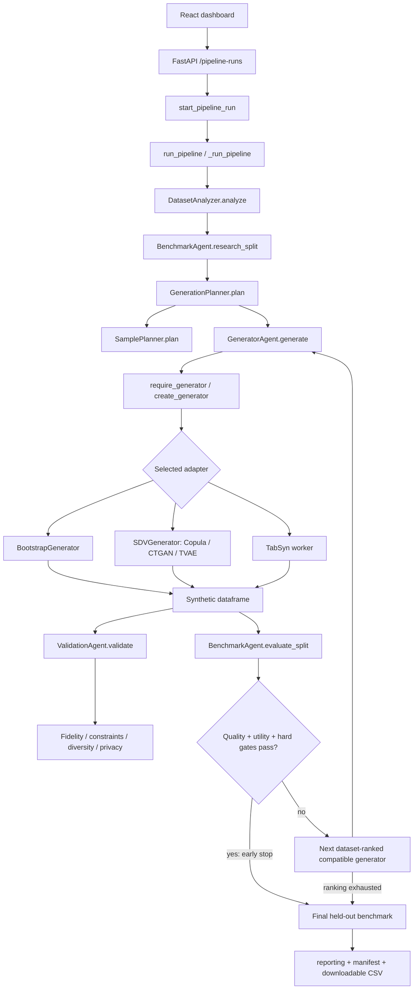
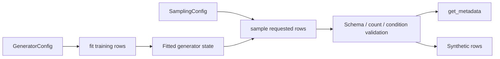
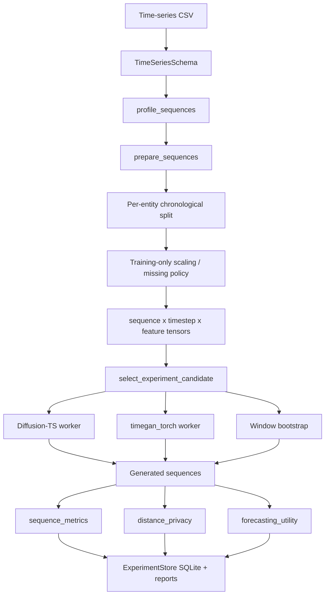
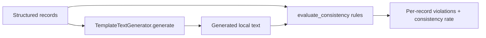

# Project AST and function-flow guide

Generated from the current `app/` Python source. This is a readable structural AST: modules, classes, functions, methods, imports and syntactic calls. `PROJECT_AST.json` contains the machine-readable index.

Start with the diagrams, then search the structural index for a function name when debugging.

## 1. Main tabular API flow

## 2. Generator lifecycle

## 3. Time-series research flow

## 4. Local text flow

## 5. Structural AST index

This section is generated from Python's `ast` module. Lines point to source definitions; calls are syntactic call names and may include library functions.

### `app.agents.analyzer`

Source: `app/agents/analyzer.py`

- class `DatasetAnalyzer` — line 28
  - `analyze(self, df, target_column, auto_detect_target)` — line 29; calls: `DatasetAnalysis`, `ValueError`, `df.duplicated`, `df.isna`, `float`, `infer_column_types`, `infer_semantic_types`, `int`, `isna`, `items`, `list`, `logger.info`
  - `_resolve_target(self, df, target_column, auto_detect_target)` — line 112; calls: `ValueError`, `c.lower`, `logger.info`
  - `_infer_task_type(self, series)` — line 137; calls: `pd.api.types.is_numeric_dtype`, `series.nunique`
  - `_numerical_stats(self, df, numerical)` — line 143; calls: `any`, `pd.to_numeric`, `s.max`, `s.mean`, `s.min`, `s.notna`, `s.skew`, `s.std`, `self._finite`, `sum`
  - `_finite(value)` — line 159; calls: `float`, `np.isfinite`
  - `_categorical_distributions(self, df, categorical)` — line 165; calls: `astype`, `float`, `head`, `str`, `value_counts`, `vc.items`
  - `_correlations(self, df, numerical)` — line 174; calls: `corr`, `fillna`, `float`, `len`, `replace`
  - `_detect_issues(self, n_rows, missing_percentage, duplicate_percentage, task_type, class_distribution, unique_value_stats, numerical_stats, numerical, categorical)` — line 185; calls: `abs`, `class_distribution.values`, `float`, `issues.append`, `join`, `len`, `max`, `min`, `np.mean`, `numerical_stats.items`, `st.get`, `unique_value_stats.items`

### `app.agents.benchmark`

Source: `app/agents/benchmark.py`

- class `BenchmarkAgent` — line 24
  - `evaluate_model_suite_cv(self, train, target_column, task_type, random_state, folds)` — line 25; calls: `BenchmarkError`, `CrossValidatedModelResult`, `ModelSuiteResult`, `float`, `get_settings`, `np.mean`, `np.median`, `np.std`, `reset_index`, `results.values`, `round`, `self._make_cv_splitter`
  - `_make_cv_splitter(target, task_type, folds, random_state)` — line 82; calls: `BenchmarkError`, `KFold`, `StratifiedKFold`, `int`, `len`, `min`, `target.value_counts`
  - `split(self, df, target_column, task_type, test_size, random_state)` — line 98; calls: `get_settings`, `test.reset_index`, `train.reset_index`, `train_test_split`
  - `research_split(self, df, target_column, task_type, test_size, validation_size, random_state)` — line 123; calls: `BenchmarkError`, `any`, `isna`, `len`, `np.arange`, `test.tolist`, `train.tolist`, `train_test_split`, `valid.tolist`
  - `evaluate_split(self, train, test, target_column, task_type, random_state, model_name)` — line 142; calls: `BenchmarkError`, `DownstreamModel`, `len`, `model.evaluate`, `model.fit`, `test.drop`, `train.drop`, `y_test.astype`, `y_train.astype`
  - `compare(self, train, test, synthetic, target_column, task_type, random_state, min_improvement, min_absolute_improvement, evaluation_role)` — line 170; calls: `BenchmarkError`, `BenchmarkResult`, `aligned.drop`, `float`, `get_settings`, `getattr`, `improvement.get`, `logger.info`, `pd.concat`, `primary_improvement`, `self.evaluate_split`, `synthetic.copy`

### `app.agents.generator`

Source: `app/agents/generator.py`

- class `GeneratorAgent` — line 25
  - `__init__(self)` — line 26; calls: —
  - `generate(self, df, plan, output_path)` — line 31; calls: `self._generate`
  - `_generate(self, df, plan, output_path)` — line 40; calls: `GeneratorError`, `Path`, `copy`, `create_generator`, `generator.generate`, `generator.get_metadata`, `get_settings`, `hasattr`, `len`, `logger.info`, `path.parent.mkdir`, `plan.generator_config.model_copy`
  - `_resolve_target_value(series, requested_value)` — line 163; calls: `GeneratorError`, `series.astype`, `str`
  - `_align_schema(original, synthetic)` — line 192; calls: `GeneratorError`, `copy`, `out.reset_index`, `pd.api.types.is_numeric_dtype`, `pd.to_numeric`
  - `_validate_condition(synthetic, condition_column, condition_value)` — line 225; calls: `GeneratorError`, `astype`, `matches.all`, `str`, `to_dict`, `value_counts`

### `app.agents.llm_reasoner`

Source: `app/agents/llm_reasoner.py`

- class `LLMReasoner` — line 14
  - `__init__(self)` — line 15; calls: `bool`, `get_settings`
  - `explain(self, payload, task)` — line 21; calls: `client.models.generate_content`, `genai.Client`, `getattr`, `json.dumps`, `logger.warning`, `self._fallback`, `str`, `text.strip`
  - `explain_final_report(self, payload, fallback)` — line 46; calls: `genai.Client`, `getattr`, `json.dumps`, `len`, `logger.warning`, `models.generate_content`, `strip`
  - `_fallback(self, payload, task)` — line 72; calls: `join`, `payload.get`

### `app.agents.model_selector`

Source: `app/agents/model_selector.py`

- `rank_tabular_generators(analysis, generation_mode, device, include_experimental, preferred_generator)` — line 19; calls: `BASE_SCORES.get`, `adjust`, `eligible.append`, `get`, `get_available_generators`, `len`, `next`, `ranked.append`, `ranked.sort`, `reasons.append`, `round`, `set`

### `app.agents.optimizer`

Source: `app/agents/optimizer.py`

- class `OptimizationAgent` — line 17
  - `_cap_sample_count(requested, original_rows)` — line 19; calls: `get_settings`, `int`, `max`, `min`
  - `_initial_sample_count(self, current_plan)` — line 24; calls: `current_plan.sample_count_details.get`, `isinstance`
  - `_next_candidate(self, current_plan, tried_generators)` — line 30; calls: `all`, `current_plan.sample_count_details.get`, `isinstance`, `self._cap_sample_count`, `self._initial_sample_count`, `set`
  - `_next_epochs(current_plan, next_generator)` — line 47; calls: `max`
  - `decide(self, iteration, max_iterations, current_plan, benchmark, validation, tried_generators, hard_gate_failures)` — line 52; calls: `OptimizationDecision`, `benchmark.improvement.get`, `logger.info`, `self._next_candidate`, `self._next_epochs`
  - `decide_unlabeled(self, iteration, max_iterations, current_plan, validation, utility, tried_generators, hard_gate_failures)` — line 114; calls: `OptimizationDecision`, `logger.info`, `self._next_candidate`, `self._next_epochs`

### `app.agents.planner`

Source: `app/agents/planner.py`

- class `GenerationPlanner` — line 17
  - `plan(self, analysis, preferred_generator, synthetic_ratio, random_state, ctgan_epochs, tvae_epochs, generator_config)` — line 18; calls: `GenerationPlan`, `GeneratorConfig`, `SamplePlanner`, `ValueError`, `cap_samples`, `get_settings`, `int`, `join`, `list`, `logger.info`, `max`, `plan`

### `app.agents.sample_planner`

Source: `app/agents/sample_planner.py`

- class `SampleCountDecision` — line 20
- class `SamplePlanner` — line 34
  - `plan(self, analysis)` — line 35; calls: `self._plan_labeled`, `self._plan_unlabeled`
  - `cap_samples(self, requested, original_rows)` — line 40; calls: `get_settings`, `int`, `logger.info`, `max`, `min`
  - `_plan_labeled(self, analysis)` — line 52; calls: `SampleCountDecision`, `counts.items`, `get_settings`, `int`, `items`, `logger.info`, `math.ceil`, `max`, `min`, `round`, `self._small_or_skip`, `self.cap_samples`
  - `_plan_unlabeled(self, analysis)` — line 117; calls: `self._small_or_skip`
  - `_small_or_skip(self, analysis, labeled)` — line 120; calls: `SampleCountDecision`, `get_settings`, `int`, `logger.info`, `round`, `self.cap_samples`, `set`

### `app.agents.validator`

Source: `app/agents/validator.py`

- class `ValidationAgent` — line 36
  - `validate(self, original, synthetic, random_state)` — line 37; calls: `ValidationResult`, `ValueError`, `basic_privacy_indicators`, `correlation_score`, `dependency_similarity`, `discover_constraints`, `discriminator_ensemble`, `distribution_details`, `distribution_score`, `diversity_score`, `fidelity_score`, `float`

### `app.api.main`

Source: `app/api/main.py`

- `_target_options(target_column)` — line 62; calls: —
- `_read_upload(file, min_rows)` — line 70; calls: `HTTPException`, `Path`, `any`, `dest.open`, `dest.resolve`, `endswith`, `file.file.read`, `file.filename.lower`, `get_settings`, `len`, `load_csv_bytes`, `ord`
- `_preview_records(df, rows)` — line 99; calls: `astype`, `df.head`, `jsonable_encoder`, `pd.notna`, `preview.to_dict`, `where`
- `_column_list(value)` — line 106; calls: `all`, `isinstance`, `item.strip`, `json.loads`, `value.split`, `value.strip`
- `_time_series_schema(timestamp_column, feature_columns, entity_column, context_columns, sequence_length, stride, missing_policy)` — line 118; calls: `TimeSeriesSchema`, `ValueError`, `_column_list`
- `_temporal_job_payload(identifier, filename)` — line 143; calls: `EXPERIMENT_STORE.get`, `failure.get`, `get`, `record.get`
- `root()` — line 164; calls: `app.get`
- `health()` — line 174; calls: `app.get`
- `generators()` — line 179; calls: `app.get`, `get_available_generators`, `get_settings`
- `research_models(probe_hardware)` — line 186; calls: `app.get`, `model_inventory`
- `experiments(limit)` — line 192; calls: `EXPERIMENT_STORE.list`, `app.get`
- `experiment(experiment_id)` — line 197; calls: `EXPERIMENT_STORE.get`, `HTTPException`, `app.get`
- `list_samples()` — line 205; calls: `app.get`
- `download_sample(sample_id)` — line 216; calls: `FileResponse`, `HTTPException`, `app.get`, `create_sample_churn_dataset`, `create_sample_timeseries_dataset`, `create_unlabeled_customer_dataset`, `path.exists`, `sample_paths.get`
- `profile_time_series(file, timestamp_column, feature_columns, entity_column, context_columns, sequence_length, stride, missing_policy)` — line 236; calls: `File`, `Form`, `HTTPException`, `_preview_records`, `_read_upload`, `_time_series_schema`, `app.post`, `list`, `prepare_sequences`, `prepared.windows.items`, `schema.model_dump`, `str`
- `analyze(file, target_column, auto_detect_target)` — line 264; calls: `DatasetAnalyzer`, `File`, `Form`, `HTTPException`, `_preview_records`, `_read_upload`, `_target_options`, `analyze`, `app.post`, `result.model_dump`, `str`
- `generate(file, target_column, generator, num_samples, auto_detect_target, device, batch_size, epochs, random_state)` — line 287; calls: `DatasetAnalyzer`, `File`, `Form`, `GenerationPlanner`, `GeneratorAgent`, `GeneratorConfig`, `HTTPException`, `Path`, `_preview_records`, `_read_upload`, `_target_options`, `analyzer.analyze`
- `plan_generation(file, target_column, generator, auto_detect_target, device, batch_size, epochs, random_state)` — line 330; calls: `DatasetAnalyzer`, `File`, `Form`, `GenerationPlanner`, `GeneratorConfig`, `HTTPException`, `_preview_records`, `_read_upload`, `_target_options`, `analysis.model_dump`, `analyze`, `app.post`
- `run(file, target_column, max_iterations, sensitive_column, preferred_generator, enable_llm, auto_detect_target, device, batch_size, epochs, random_state, test_size, validation_size)` — line 366; calls: `File`, `Form`, `GeneratorConfig`, `HTTPException`, `PipelineConfig`, `_preview_records`, `_read_upload`, `_target_options`, `app.post`, `output.result.model_dump`, `run_pipeline`, `str`
- `start_pipeline_run(file, modality, target_column, max_iterations, sensitive_column, preferred_generator, enable_llm, auto_detect_target, device, batch_size, epochs, random_state, test_size, validation_size, timestamp_column, entity_column, feature_columns, context_columns, sequence_length, stride, missing_policy, num_sequences, temporal_epochs, temporal_batch_size, hidden_dim, layers, heads, timesteps, sampling_steps, forecast_target, forecast_horizon)` — line 414; calls: `ExperimentConfig`, `File`, `Form`, `GeneratorConfig`, `HTTPException`, `PipelineConfig`, `SequenceConfig`, `Thread`, `ValueError`, `_preview_records`, `_read_upload`, `_target_options`
- `get_pipeline_run(job_id)` — line 550; calls: `EXPERIMENT_STORE.get`, `HTTPException`, `PIPELINE_JOBS.get`, `_temporal_job_payload`, `app.get`, `get`, `job.get`, `record.get`
- `download_experiment_synthetic(experiment_id)` — line 566; calls: `EXPERIMENT_STORE.directory`, `EXPERIMENT_STORE.get`, `FileResponse`, `HTTPException`, `app.get`, `exists`
- `get_run(run_id)` — line 579; calls: `HTTPException`, `JSONResponse`, `Path`, `__import__`, `app.get`, `get_settings`, `loads`, `model_dump`, `path.exists`, `path.read_text`
- `download_synthetic(run_id)` — line 590; calls: `FileResponse`, `HTTPException`, `Path`, `app.get`, `data.get`, `exists`, `get_settings`, `json.loads`, `save_csv`, `stored.exists`, `stored.read_text`
- `get_run_manifest(run_id)` — line 615; calls: `HTTPException`, `Path`, `app.get`, `get_settings`, `json.loads`, `path.exists`, `path.read_text`, `re.fullmatch`

### `app.config`

Source: `app/config.py`

- `get_settings()` — line 61; calls: `Settings`
- class `Settings : BaseSettings` — line 9

### `app.evaluation.advanced_similarity`

Source: `app/evaluation/advanced_similarity.py`

- `dependency_similarity(original, synthetic)` — line 24; calls: `_categorical_dependency_similarity`, `_matrix_similarity`, `_mixed_dependency_similarity`, `float`, `infer_column_types`, `list`, `np.mean`, `parts.items`, `parts.values`, `round`
- `mmd_similarity(original, synthetic, random_state)` — line 50; calls: `_balanced_samples`, `_preprocessor`, `fit_transform`, `float`, `get_settings`, `hasattr`, `len`, `max`, `mean`, `np.asarray`, `np.linalg.norm`, `np.median`
- `discriminator_ensemble(original, synthetic, random_state)` — line 85; calls: `HistGradientBoostingClassifier`, `LogisticRegression`, `RandomForestClassifier`, `_balanced_samples`, `_preprocessor`, `abs`, `aucs.append`, `float`, `get_settings`, `hasattr`, `len`, `max`
- `_balanced_samples(original, synthetic, cap, random_state)` — line 137; calls: `len`, `min`, `pd.DataFrame`, `reset_index`, `sample`
- `_preprocessor(df)` — line 150; calls: `ColumnTransformer`, `OneHotEncoder`, `Pipeline`, `SimpleImputer`, `StandardScaler`, `ValueError`, `infer_column_types`, `transformers.append`
- `_matrix_similarity(original, synthetic, columns, method)` — line 162; calls: `corr`, `fillna`, `float`, `len`, `mean`, `np.abs`, `np.clip`, `np.triu_indices`, `to_numpy`
- `_cramers_v(first, second)` — line 171; calls: `first.astype`, `float`, `min`, `np.maximum`, `np.outer`, `np.sqrt`, `observed.sum`, `pd.crosstab`, `second.astype`, `sum`, `table.to_numpy`
- `_categorical_dependency_similarity(original, synthetic, columns)` — line 181; calls: `_cramers_v`, `abs`, `differences.append`, `enumerate`, `float`, `len`, `np.clip`, `np.mean`
- `_correlation_ratio(categories, values)` — line 191; calls: `categories.astype`, `dropna`, `float`, `frame.groupby`, `len`, `mean`, `np.sqrt`, `nunique`, `pd.DataFrame`, `pd.to_numeric`, `sum`
- `_mixed_dependency_similarity(original, synthetic, numerical, categorical)` — line 201; calls: `_correlation_ratio`, `abs`, `float`, `np.clip`, `np.mean`

### `app.evaluation.constraints`

Source: `app/evaluation/constraints.py`

- `discover_constraints(df, semantic_types)` — line 13; calls: `any`, `astype`, `categories.index.tolist`, `dropna`, `float`, `get`, `index.tolist`, `infer_semantic_types`, `isoformat`, `len`, `max`, `np.allclose`
- `validate_constraints(real_df, synthetic_df, constraints)` — line 64; calls: `_rule_violations`, `bad.sum`, `discover_constraints`, `discovered.get`, `float`, `int`, `items`, `len`, `np.clip`, `round`, `sum`, `violations.values`
- `_rule_violations(series, rule)` — line 112; calls: `isin`, `np.isclose`, `np.round`, `numeric.notna`, `parsed.notna`, `pd.Timestamp`, `pd.to_datetime`, `pd.to_numeric`, `series.astype`, `series.notna`

### `app.evaluation.diversity`

Source: `app/evaluation/diversity.py`

- `diversity_score(original, synthetic)` — line 17; calls: `a.max`, `a.min`, `astype`, `b.max`, `b.min`, `coverages.append`, `details.values`, `dropna`, `float`, `infer_column_types`, `len`, `list`

### `app.evaluation.fairness`

Source: `app/evaluation/fairness.py`

- `group_performance(y_true, y_pred, groups, task_type)` — line 13; calls: `FairnessResult`, `_safe_f1`, `_safe_prf`, `float`, `frame.groupby`, `groups.astype`, `len`, `m.get`, `max`, `metrics.values`, `min`, `nunique`
- `_safe_f1(y_true, y_pred)` — line 40; calls: `f1_score`, `float`
- `_safe_prf(fn, part)` — line 47; calls: `float`, `fn`

### `app.evaluation.fidelity`

Source: `app/evaluation/fidelity.py`

- `_safe_series(s)` — line 21; calls: `s.dropna`
- `fidelity_score(original, synthetic)` — line 25; calls: `_safe_series`, `abs`, `astype`, `dropna`, `float`, `infer_column_types`, `ks_2samp`, `len`, `list`, `np.clip`, `np.mean`, `p.get`
- `distribution_score(original, synthetic)` — line 50; calls: `_safe_series`, `a.std`, `abs`, `astype`, `dropna`, `float`, `infer_column_types`, `len`, `np.clip`, `np.mean`, `p.get`, `parts.append`
- `distribution_details(original, synthetic)` — line 78; calls: `_safe_series`, `astype`, `dropna`, `fake.max`, `fake.min`, `float`, `infer_column_types`, `jensenshannon`, `ks_2samp`, `len`, `max`, `mean`
- `correlation_score(original, synthetic)` — line 133; calls: `corr`, `corr_a.to_numpy`, `corr_b.reindex`, `corr_b.to_numpy`, `fillna`, `float`, `infer_column_types`, `len`, `mean`, `np.abs`, `np.clip`, `np.triu_indices`

### `app.evaluation.privacy`

Source: `app/evaluation/privacy.py`

- `basic_privacy_indicators(original, synthetic, sample_size, random_state)` — line 21; calls: `_nearest_neighbor_rate`, `_risk_level`, `apply`, `float`, `len`, `max`, `np.clip`, `orig_t.tolist`, `original.astype`, `r.tolist`, `set`, `sum`
- `_risk_level(exact_duplicate_rate, high_similarity_rate)` — line 47; calls: —
- `_nearest_neighbor_rate(original, synthetic, sample_size, random_state, threshold)` — line 56; calls: `a.max`, `a.min`, `a.notna`, `abs`, `any`, `float`, `infer_column_types`, `len`, `min`, `np.random.default_rng`, `orig_sample.iterrows`, `pd.Series`

### `app.evaluation.unsupervised_utility`

Source: `app/evaluation/unsupervised_utility.py`

- `evaluate_unsupervised_utility(original, synthetic, random_state)` — line 39; calls: `UnsupervisedUtilityResult`, `_knn_similarity_score`, `_pca_structure_score`, `correlation_score`, `distribution_score`, `diversity_score`, `float`, `get_settings`, `np.mean`, `round`, `scores.append`
- `_pca_structure_score(original, synthetic)` — line 74; calls: `PCA`, `StandardScaler`, `apply`, `diff.mean`, `dropna`, `fit`, `float`, `infer_column_types`, `len`, `min`, `np.abs`, `np.clip`
- `_knn_similarity_score(original, synthetic, random_state)` — line 104; calls: `ColumnTransformer`, `KNeighborsClassifier`, `OneHotEncoder`, `Pipeline`, `SimpleImputer`, `StandardScaler`, `abs`, `copy`, `float`, `get_settings`, `infer_column_types`, `int`

### `app.evaluation.utility`

Source: `app/evaluation/utility.py`

- `primary_improvement(baseline, augmented)` — line 8; calls: `abs`, `float`

### `app.evaluation.watermark`

Source: `app/evaluation/watermark.py`

- `provenance_fingerprint(df, generator, random_seed)` — line 12; calls: `ProvenanceFingerprint`, `df.to_csv`, `encode`, `hashlib.sha256`, `hexdigest`, `len`, `list`, `utc_now`

### `app.generators.base`

Source: `app/generators/base.py`

- class `AdvancedConfig : BaseModel` — line 10
- class `GeneratorConfig : BaseModel` — line 24
- class `SamplingConfig : BaseModel` — line 32
- class `BaseSyntheticGenerator : ABC` — line 41
  - `validate_input(self, data)` — line 44; calls: `GeneratorError`, `all`, `any`, `data.columns.duplicated`, `data.select_dtypes`, `isinstance`, `np.isinf`, `to_numpy`
  - `get_capabilities(self)` — line 53; calls: `asdict`
  - `fit(self, data, config)` — line 59; calls: —
  - `sample(self, num_samples, config)` — line 63; calls: —
  - `get_metadata(self)` — line 67; calls: —
  - `generate(self, df, num_samples, random_state, epochs, condition_column, condition_value, config)` — line 70; calls: `GeneratorConfig`, `SamplingConfig`, `self._validate_sampling`, `self.fit`, `self.sample`
  - `_validate_sampling(self, num_samples, config)` — line 79; calls: `GeneratorError`, `isinstance`

### `app.generators.bootstrap_generator`

Source: `app/generators/bootstrap_generator.py`

- class `BootstrapGenerator : BaseSyntheticGenerator` — line 17
  - `fit(self, data, config)` — line 20; calls: `GeneratorConfig`, `GeneratorError`, `cfg.model_copy`, `data.copy`, `np.random.default_rng`, `resolve_device`, `self.validate_input`
  - `sample(self, num_samples, config)` — line 34; calls: `GeneratorError`, `SamplingConfig`, `getattr`, `self._sample_from_frame`, `self._validate_sampling`
  - `get_metadata(self)` — line 42; calls: `getattr`, `list`, `self._config.model_dump`
  - `_sample_from_frame(self, df, num_samples, random_state, epochs, condition_column, condition_value)` — line 48; calls: `GeneratorError`, `astype`, `conditioned.reset_index`, `copy`, `df.copy`, `float`, `infer_column_types`, `len`, `logger.info`, `np.random.default_rng`, `np.rint`, `original.max`

### `app.generators.copula_generator`

Source: `app/generators/copula_generator.py`

- class `GaussianCopulaGenerator : SDVGenerator` — line 4

### `app.generators.ctgan_generator`

Source: `app/generators/ctgan_generator.py`

- class `CTGANGenerator : SDVGenerator` — line 4

### `app.generators.registry`

Source: `app/generators/registry.py`

- `register_generator(name, registration)` — line 62; calls: `GeneratorError`, `re.fullmatch`
- `require_generator(name, include_experimental)` — line 71; calls: `GENERATOR_REGISTRY.get`, `GeneratorError`, `get_available_generators`
- `get_available_generators(include_experimental)` — line 83; calls: `GENERATOR_REGISTRY.items`, `asdict`, `find_spec`, `registration.availability_check`
- `create_generator(name, include_experimental)` — line 111; calls: `GeneratorError`, `all`, `callable`, `getattr`, `registration.factory`, `require_generator`
- class `GeneratorCapabilities` — line 20
- class `GeneratorRegistration` — line 40

### `app.generators.runtime`

Source: `app/generators/runtime.py`

- `resolve_device(requested, supports_gpu, supports_cpu)` — line 13; calls: `GeneratorError`, `torch.cuda.is_available`
- `seeded_execution(seed, neural, device)` — line 31; calls: `np.random.get_state`, `np.random.seed`, `np.random.set_state`, `random.getstate`, `random.seed`, `random.setstate`, `torch.cuda.current_device`, `torch.cuda.manual_seed`, `torch.random.default_generator.manual_seed`, `torch.random.fork_rng`

### `app.generators.sdv_common`

Source: `app/generators/sdv_common.py`

- `validate_input_dataframe(df)` — line 22; calls: `GeneratorError`, `any`, `df.columns.duplicated`, `df.copy`, `head`, `isinstance`, `len`, `logger.warning`, `out.reset_index`, `series.astype`, `series.dropna`, `tolist`
- `build_metadata(df)` — line 64; calls: `GeneratorError`, `SingleTableMetadata`, `_classify_column`, `_remove_auto_primary_key`, `_update_column`, `callable`, `detected.get`, `get`, `getattr`, `len`, `logger.info`, `metadata.detect_from_dataframe`
- `_remove_auto_primary_key(metadata)` — line 121; calls: `GeneratorError`, `metadata.remove_primary_key`, `metadata.to_dict`
- `_update_column(metadata, column, decision)` — line 131; calls: `GeneratorError`, `metadata.update_column`
- `_classify_column(series, column, detected)` — line 140; calls: `_is_boolean_like`, `_is_id_like`, `_is_integer_like`, `detected.get`, `int`, `is_bool_dtype`, `is_categorical_dtype`, `is_datetime64_any_dtype`, `is_numeric_dtype`, `non_null.nunique`, `series.dropna`
- `_is_boolean_like(series)` — line 164; calls: `lower`, `series.unique`, `str`, `strip`
- `_is_id_like(series, column)` — line 171; calls: `any`, `bool`, `column.lower`, `len`, `name.endswith`, `non_null.nunique`, `series.dropna`
- `_is_integer_like(series)` — line 180; calls: `all`, `bool`, `dropna`, `is_numeric_dtype`, `pd.to_numeric`
- `set_random_state(synthesizer, random_state)` — line 187; calls: `GeneratorError`, `callable`, `getattr`, `logger.info`, `logger.warning`, `method`
- `fit_sdv(synthesizer, df, random_state)` — line 215; calls: `GeneratorError`, `set_random_state`, `synthesizer.fit`, `validate_input_dataframe`
- `sample_sdv(synthesizer, num_samples, condition_column, condition_value, max_tries_per_batch)` — line 232; calls: `Condition`, `GeneratorError`, `callable`, `conditional_sampler`, `getattr`, `isinstance`, `len`, `pd.DataFrame`, `synthesizer.sample`, `synthetic.reset_index`
- `validate_generated_output(original, synthetic, expected_rows)` — line 310; calls: `GeneratorError`, `copy`, `len`, `synthetic.reset_index`

### `app.generators.sdv_generator`

Source: `app/generators/sdv_generator.py`

- class `SDVGenerator : BaseSyntheticGenerator` — line 16
  - `fit(self, data, config)` — line 20; calls: `GeneratorConfig`, `GeneratorError`, `build_metadata`, `cfg.model_dump`, `constructor`, `copy`, `fit_sdv`, `getattr`, `inspect.signature`, `kwargs.update`, `len`, `message.lower`
  - `sample(self, num_samples, config)` — line 67; calls: `GeneratorError`, `SamplingConfig`, `callable`, `cfg.model_dump`, `getattr`, `hasattr`, `message.lower`, `sample_sdv`, `sampling_metadata.get`, `seeded_execution`, `self._validate_sampling`, `str`
  - `get_metadata(self)` — line 95; calls: `getattr`, `self._config.model_dump`, `version`

### `app.generators.tabsyn_generator`

Source: `app/generators/tabsyn_generator.py`

- class `TabSynGenerator : BaseSyntheticGenerator` — line 17
  - `_worker(self, operation, count)` — line 20; calls: `GeneratorError`, `int`, `os.environ.get`, `str`, `subprocess.run`, `worker_python`
  - `fit(self, data, config)` — line 27; calls: `GeneratorConfig`, `Path`, `cfg.model_dump`, `data.to_csv`, `get_settings`, `json.dumps`, `resolve`, `self._worker`, `self.directory.mkdir`, `self.validate_input`, `source_path`, `str`
  - `sample(self, num_samples, config)` — line 41; calls: `GeneratorError`, `SamplingConfig`, `getattr`, `len`, `pd.read_csv`, `self._validate_sampling`, `self._worker`
  - `get_metadata(self)` — line 54; calls: `getattr`, `json.loads`, `read_text`, `str`
  - `load(cls, directory)` — line 61; calls: `GeneratorError`, `Path`, `cls`, `exists`, `json.loads`, `read_text`, `resolve`, `source_path`

### `app.generators.tvae_generator`

Source: `app/generators/tvae_generator.py`

- class `TVAEGenerator : SDVGenerator` — line 4

### `app.models.benchmark_model`

Source: `app/models/benchmark_model.py`

- class `DownstreamModel` — line 33
  - `__init__(self, task_type, random_state, model_name)` — line 34; calls: —
  - `fit(self, X, y)` — line 40; calls: `BenchmarkError`, `ColumnTransformer`, `OneHotEncoder`, `Pipeline`, `SimpleImputer`, `StandardScaler`, `infer_column_types`, `self._make_estimator`, `self.pipeline.fit`, `transformers.append`
  - `predict(self, X)` — line 67; calls: `BenchmarkError`, `self.pipeline.predict`
  - `evaluate(self, X, y, n_train)` — line 72; calls: `BenchmarkError`, `self._classification_metrics`, `self._regression_metrics`, `self.pipeline.predict`
  - `_make_estimator(self)` — line 80; calls: `HistGradientBoostingClassifier`, `HistGradientBoostingRegressor`, `LogisticRegression`, `RandomForestClassifier`, `RandomForestRegressor`, `Ridge`
  - `_classification_metrics(self, y, preds, X, n_train)` — line 105; calls: `ModelMetrics`, `accuracy_score`, `f1_score`, `float`, `hasattr`, `int`, `len`, `precision_score`, `recall_score`, `roc_auc_score`, `self.pipeline.predict_proba`, `y.nunique`
  - `_regression_metrics(self, y, preds, n_train)` — line 131; calls: `ModelMetrics`, `float`, `int`, `len`, `mean_absolute_error`, `mean_squared_error`, `r2_score`

### `app.pipeline.candidates`

Source: `app/pipeline/candidates.py`

- `propose_candidates(plan)` — line 53; calls: `GeneratorCandidate`, `_plan_hyperparameters`, `any`, `availability.get`, `candidates.append`, `get`, `get_available_generators`, `get_settings`, `int`, `len`, `max`, `min`
- `_plan_hyperparameters(plan, generator_name)` — line 83; calls: —
- class `GeneratorCandidate` — line 21
  - `cache_key(self, dataframe, random_state, condition)` — line 27; calls: `digest.hexdigest`, `digest.update`, `encode`, `items`, `list`, `pd.util.hash_pandas_object`, `repr`, `self.generator_name.encode`, `self.hyperparameters.items`, `sha256`, `sorted`, `str`
- class `CandidateCache` — line 39
  - `__init__(self)` — line 42; calls: —
  - `get(self, key)` — line 45; calls: `self._values.get`, `value.copy`
  - `put(self, key, value)` — line 49; calls: `value.copy`

### `app.pipeline.orchestrator`

Source: `app/pipeline/orchestrator.py`

- `run_pipeline(df, target_column, config)` — line 91; calls: `Path`, `PipelineConfig`, `_run_pipeline`, `asdict`, `df.to_csv`, `directory.mkdir`, `encode`, `get_settings`, `hasattr`, `hexdigest`, `json.dumps`, `manifest.update`
- `_run_pipeline(df, target_column, config, run_id)` — line 132; calls: `AgentLog`, `BenchmarkAgent`, `DatasetAnalyzer`, `DownstreamModel`, `GenerationPlan`, `GenerationPlanner`, `GeneratorAgent`, `GeneratorConfig`, `IterationRecord`, `LLMReasoner`, `OptimizationAgent`, `Path`
- `_hard_gate_failures(validation)` — line 639; calls: `failures.append`, `get_settings`, `isinstance`, `privacy_details.get`, `validation.details.get`
- class `PipelineConfig` — line 45
  - `__post_init__(self)` — line 63; calls: `GeneratorConfig`, `GeneratorConfig.model_validate`, `ValueError`, `getattr`, `isinstance`, `math.isfinite`
- class `PipelineOutput` — line 82

### `app.pipeline.reporting`

Source: `app/pipeline/reporting.py`

- `build_final_report_payload(result)` — line 11; calls: `_failure_reasons`, `_family`, `candidates.append`, `next`, `result.baseline.model_dump`
- `deterministic_final_report(payload)` — line 43; calls: `dataset.get`, `item.get`, `join`, `payload.get`
- `_family(generator)` — line 74; calls: `get`
- `_failure_reasons(item)` — line 78; calls: `get_settings`, `item.validation.details.get`, `privacy.get`, `reasons.append`

### `app.pipeline.selection`

Source: `app/pipeline/selection.py`

- `apply_hard_gates(candidate)` — line 11; calls: `failed.append`, `get_settings`, `join`
- `select_candidate(candidates, mode)` — line 30; calls: `_dominates`, `_priority_score`, `any`, `apply_hard_gates`, `max`
- `_dominates(left, right, mode)` — line 47; calls: `_objectives`, `all`, `any`, `zip`
- `_objectives(candidate, mode)` — line 53; calls: —
- `_priority_score(candidate, mode)` — line 67; calls: —

### `app.research.codec`

Source: `app/research/codec.py`

- class `MixedTableCodec` — line 7
  - `fit_transform(self, frame)` — line 8; calls: `QuantileTransformer`, `any`, `append`, `astype`, `cats.append`, `dict.fromkeys`, `enumerate`, `float`, `isinstance`, `len`, `list`, `min`
  - `inverse(self, numerical, categorical)` — line 34; calls: `QuantileTransformer`, `astype`, `dtype.startswith`, `enumerate`, `items`, `len`, `np.array`, `pd.DataFrame`, `pd.to_numeric`, `ravel`, `reshape`, `round`

### `app.research.config`

Source: `app/research/config.py`

- class `ExperimentConfig : BaseModel` — line 8
  - `modalities(self)` — line 31; calls: `ValueError`, `model_validator`

### `app.research.engine`

Source: `app/research/engine.py`

- `_write(path, payload)` — line 31; calls: `json.dumps`, `path.write_text`
- `submit_experiment(frame, config, store, dataset_identifier)` — line 35; calls: `EXECUTOR.submit`, `config.model_dump`, `encode`, `frame.to_csv`, `hexdigest`, `sha256`, `store.create`, `store.directory`, `store.get`
- `execute_experiment(identifier, store)` — line 42; calls: `ExperimentConfig`, `_write`, `now`, `pd.read_csv`, `platform.platform`, `platform.python_version`, `store.directory`, `store.event`, `store.get`, `store.update`, `str`, `tabular_experiment`
- `_split_table(frame, config)` — line 72; calls: `BenchmarkAgent`, `DatasetAnalyzer`, `ValueError`, `_infer_task_type`, `len`, `np.arange`, `research_split`, `reset_index`, `splits.items`, `test.tolist`, `train.tolist`, `train_test_split`
- `_efficiency(metadata, fit_time, sample_time, count)` — line 86; calls: `metadata.get`
- `tabular_experiment(frame, config, directory, store, identifier)` — line 95; calls: `BenchmarkAgent`, `DownstreamModel`, `ValidationAgent`, `ValueError`, `_candidate_names`, `_efficiency`, `_hard_gate_failures`, `_split_table`, `_write`, `agent.evaluate_split`, `astype`, `augmented.model_dump`
- `temporal_experiment(frame, config, directory, store, identifier)` — line 151; calls: `SEQUENCE_GENERATORS.get`, `ValueError`, `_candidate_names`, `_efficiency`, `_temporal_gates`, `_write`, `config.sequence_config.model_copy`, `config.sequence_schema.features.index`, `distance_privacy`, `factory`, `float`, `forecasting_utility`
- `_candidate_names(frame, config)` — line 205; calls: `ValueError`, `plan_experiment`
- `_temporal_gates(quality, privacy, config)` — line 216; calls: `failures.append`, `np.mean`

### `app.research.evaluation`

Source: `app/research/evaluation.py`

- `sequence_metrics(real, synthetic)` — line 10; calls: `ValueError`, `a.mean`, `a.ravel`, `a.std`, `a.var`, `abs`, `acf`, `acf_errors.append`, `all`, `b.mean`, `b.ravel`, `b.std`
- `distance_privacy(train, holdout, synthetic, seed, cap, numerical)` — line 58; calls: `astype`, `cdist`, `distances`, `float`, `frame.sample`, `isin`, `isinstance`, `len`, `list`, `mean`, `min`, `np.abs`
- `forecasting_utility(train, test, synthetic, target_index, horizon, span)` — line 102; calls: `Ridge`, `ValueError`, `fit`, `float`, `len`, `mean_absolute_error`, `mean_squared_error`, `model.predict`, `np.concatenate`, `np.sqrt`, `reshape`, `xy`

### `app.research.ingestion`

Source: `app/research/ingestion.py`

- `read_table(content, filename, max_bytes)` — line 6; calls: `BytesIO`, `ValueError`, `any`, `endswith`, `filename.lower`, `frame.columns.duplicated`, `len`, `pd.read_csv`, `pd.read_parquet`

### `app.research.planner`

Source: `app/research/planner.py`

- `worker_hardware(interpreter)` — line 13; calls: `json.loads`, `lru_cache`, `str`, `subprocess.run`
- `worker_dependencies(interpreter)` — line 23; calls: `json.loads`, `lru_cache`, `str`, `subprocess.run`
- `model_inventory(allow_experimental, probe_hardware)` — line 33; calls: `dependencies.get`, `get_available_generators`, `source_status`, `status.update`, `tables.items`, `worker_dependencies`, `worker_hardware`, `worker_python`
- `plan_experiment(frame, config)` — line 61; calls: `DatasetAnalyzer`, `analysis.model_dump`, `analyze`, `len`, `model_inventory`, `profile_sequences`

### `app.research.selection`

Source: `app/research/selection.py`

- `select_experiment_candidate(config, names, evaluate)` — line 5; calls: `ValueError`, `any`, `bool`, `completed.append`, `dict.fromkeys`, `evaluate`, `max`, `str`, `time.perf_counter`, `trials.append`, `type`

### `app.research.sources`

Source: `app/research/sources.py`

- `worker_python()` — line 14; calls: `os.environ.get`, `overlay.exists`, `str`
- `source_path(name, verify)` — line 19; calls: `GeneratorError`, `Path`, `exists`, `modified.strip`, `os.environ.get`, `resolve`, `str`, `strip`, `subprocess.check_output`
- `source_status(name)` — line 34; calls: `source_path`, `str`

### `app.research.store`

Source: `app/research/store.py`

- `now()` — line 9; calls: `datetime.now`, `isoformat`
- class `ExperimentStore` — line 13
  - `__init__(self, root)` — line 14; calls: `Path`, `connection.execute`, `resolve`, `self.connect`, `self.root.mkdir`
  - `connect(self)` — line 23; calls: `connection.execute`, `sqlite3.connect`
  - `create(self, config, dataset_hash, dataset_identifier)` — line 28; calls: `connection.execute`, `directory.mkdir`, `json.dumps`, `now`, `self.connect`, `uuid4`, `write_text`
  - `get(self, identifier)` — line 41; calls: `KeyError`, `connection.execute`, `fetchone`, `json.loads`, `self.connect`
  - `update(self, identifier, **changes)` — line 48; calls: `KeyError`, `connection.execute`, `fetchone`, `json.dumps`, `json.loads`, `now`, `payload.update`, `self.connect`
  - `event(self, identifier, stage, message)` — line 61; calls: `now`, `self.get`, `self.update`
  - `list(self, limit)` — line 65; calls: `connection.execute`, `fetchall`, `json.loads`, `max`, `min`, `self.connect`
  - `recover_interrupted(self)` — line 71; calls: `connection.execute`, `fetchall`, `self.connect`, `self.update`
  - `directory(self, identifier)` — line 78; calls: `self.get`

### `app.schemas.schemas`

Source: `app/schemas/schemas.py`

- `utc_now()` — line 259; calls: `datetime.utcnow`, `isoformat`, `replace`
- class `DatasetAnalysis : BaseModel` — line 12
- class `GenerationPlan : BaseModel` — line 37
  - `registered_generator(cls, value)` — line 62; calls: `ValueError`, `field_validator`
- class `ValidationResult : BaseModel` — line 69
- class `UnsupervisedUtilityResult : BaseModel` — line 82
- class `ModelMetrics : BaseModel` — line 96
- class `BenchmarkResult : BaseModel` — line 113
- class `CrossValidatedModelResult : BaseModel` — line 127
- class `ModelSuiteResult : BaseModel` — line 135
- class `CandidateEvaluation : BaseModel` — line 143
- class `OptimizationDecision : BaseModel` — line 166
- class `AgentLog : BaseModel` — line 178
- class `IterationRecord : BaseModel` — line 184
- class `ProvenanceFingerprint : BaseModel` — line 199
- class `FairnessResult : BaseModel` — line 209
- class `PipelineResult : BaseModel` — line 216
- class `PipelineConfigModel : BaseModel` — line 242

### `app.text.consistency`

Source: `app/text/consistency.py`

- `evaluate_consistency(records, texts, rules)` — line 6; calls: `ValueError`, `expected.lower`, `len`, `mapping.get`, `matched.append`, `re.escape`, `re.search`, `results.append`, `rules.items`, `str`, `sum`, `text.lower`

### `app.text.generator`

Source: `app/text/generator.py`

- class `TextGenerationConfig` — line 7
- class `TemplateTextGenerator` — line 13
  - `__init__(self, config)` — line 18; calls: `TextGenerationConfig`
  - `generate(self, records)` — line 21; calls: `enumerate`, `join`, `keys`, `record.get`, `rendered.append`, `self.config.template.format`, `tuple`

### `app.timeseries.data`

Source: `app/timeseries/data.py`

- `profile_sequences(frame, schema)` — line 41; calls: `ValueError`, `any`, `data.groupby`, `entities.append`, `frame.copy`, `int`, `irregular.sum`, `isna`, `len`, `max`, `np.abs`, `np.diff`
- `prepare_sequences(frame, schema)` — line 66; calls: `PreparedSequences`, `ValueError`, `all`, `any`, `append`, `apply`, `astype`, `batches.append`, `chunk.__source_row__.tolist`, `cleaned.items`, `copy`, `data.groupby`
- `inverse_sequences(values, metadata)` — line 127; calls: `np.array`
- `sequences_to_frame(values, metadata)` — line 131; calls: `TimeSeriesSchema`, `enumerate`, `frame.insert`, `inverse_sequences`, `pd.DataFrame`, `pd.Timedelta`, `pd.concat`, `pd.date_range`, `rows.append`
- class `TimeSeriesSchema : BaseModel` — line 9
  - `validate_roles(self)` — line 24; calls: `ValueError`, `len`, `model_validator`, `pd.Timestamp`, `set`
- class `PreparedSequences` — line 35

### `app.timeseries.generators`

Source: `app/timeseries/generators.py`

- class `SequenceConfig : BaseModel` — line 18
  - `consistent(self)` — line 33; calls: `ValueError`, `model_validator`
- class `SequenceGenerator` — line 41
  - `_worker(self, operation, count)` — line 44; calls: `GeneratorError`, `int`, `os.environ.get`, `str`, `subprocess.run`, `worker_python`
  - `fit(self, windows, config, metadata)` — line 53; calls: `GeneratorError`, `Path`, `SequenceConfig`, `all`, `cfg.model_dump`, `get_settings`, `json.dumps`, `list`, `np.isfinite`, `np.save`, `resolve`, `self._worker`
  - `sample(self, num_sequences)` — line 69; calls: `GeneratorError`, `all`, `getattr`, `isinstance`, `json.loads`, `np.isfinite`, `np.load`, `read_text`, `self._worker`
  - `get_metadata(self)` — line 79; calls: `json.loads`, `read_text`, `str`
  - `load(cls, directory)` — line 83; calls: `GeneratorError`, `Path`, `cls`, `exists`, `json.loads`, `read_text`, `resolve`, `source_path`
- class `TimeGANGenerator : SequenceGenerator` — line 97
- class `WindowBootstrapGenerator` — line 101
  - `fit(self, windows, config, metadata)` — line 105; calls: `GeneratorError`, `SequenceConfig`, `all`, `copy`, `np.asarray`, `np.isfinite`, `time.perf_counter`
  - `sample(self, count)` — line 119; calls: `copy`, `integers`, `len`, `np.random.default_rng`
  - `get_metadata(self)` — line 122; calls: —

### `app.timeseries.timegan`

Source: `app/timeseries/timegan.py`

- class `RecurrentBlock : nn.Module` — line 11
  - `__init__(self, inputs, hidden, outputs, layers, sigmoid)` — line 12; calls: `__init__`, `nn.GRU`, `nn.Linear`, `super`
  - `forward(self, values)` — line 18; calls: `self.gru`, `self.projection`, `values.sigmoid`
- class `TimeGAN : nn.Module` — line 23
  - `__init__(self, features, hidden, layers)` — line 24; calls: `RecurrentBlock`, `__init__`, `max`, `nn.ModuleDict`, `super`
  - `sample(self, count, length, device)` — line 35; calls: `torch.rand`
  - `train_phases(self, loader, epochs, learning_rate, device)` — line 40; calls: `F.binary_cross_entropy_with_logits`, `F.mse_loss`, `ValueError`, `abs`, `adversarial`, `batch.to`, `detach`, `discriminator_loss.detach`, `embed_loss.detach`, `float`, `generator_loss.detach`, `history.update`

### `app.utils.data_utils`

Source: `app/utils/data_utils.py`

- `load_csv(path)` — line 37; calls: `InvalidDatasetError`, `pd.read_csv`, `validate_dataframe`
- `load_csv_bytes(content, filename)` — line 45; calls: `BytesIO`, `InvalidDatasetError`, `endswith`, `filename.lower`, `get_settings`, `len`, `pd.read_csv`, `validate_dataframe`
- `validate_dataframe(df, min_rows)` — line 61; calls: `InvalidDatasetError`, `any`, `df.columns.duplicated`, `df.copy`, `get_settings`, `len`, `str`, `strip`
- `infer_column_types(df)` — line 78; calls: `categorical.append`, `col.lower`, `int`, `len`, `list`, `max`, `numerical.append`, `pd.api.types.is_float_dtype`, `pd.api.types.is_numeric_dtype`, `series.nunique`
- `infer_semantic_types(df, target_column)` — line 104; calls: `_infer_semantic_type`, `float`, `int`, `len`, `lower`, `max`, `mean`, `non_null.nunique`, `round`, `series.dropna`, `series.isna`, `str`
- `_infer_semantic_type(series, name, unique_ratio, unique_count, is_target)` — line 134; calls: `_is_boolean`, `_is_datetime`, `_is_identifier`, `any`, `astype`, `dropna`, `float`, `mean`, `np.allclose`, `np.round`, `pd.api.types.is_numeric_dtype`, `pd.to_numeric`
- `_is_boolean(series)` — line 169; calls: `bool`, `len`, `lower`, `series.dropna`, `str`, `strip`, `unique`
- `_is_datetime(series, name)` — line 174; calls: `any`, `astype`, `float`, `len`, `mean`, `parsed.notna`, `pd.api.types.is_numeric_dtype`, `pd.to_datetime`, `series.dropna`, `str.strip`, `text.str.contains`
- `_is_identifier(series, name, unique_ratio)` — line 188; calls: `IDENTIFIER_NAME_PATTERN.search`, `astype`, `bool`, `float`, `len`, `np.all`, `np.diff`, `pd.api.types.is_integer_dtype`, `series.dropna`, `to_numpy`, `uuid_like.mean`, `values.str.fullmatch`
- `save_csv(df, path)` — line 203; calls: `Path`, `df.to_csv`, `path.parent.mkdir`
- `create_sample_churn_dataset(path, n_rows, seed)` — line 210; calls: `clip`, `int`, `max`, `np.argsort`, `np.random.default_rng`, `np.zeros`, `pd.DataFrame`, `rng.choice`, `rng.integers`, `rng.normal`, `round`, `save_csv`
- `create_unlabeled_customer_dataset(path, n_rows, seed)` — line 263; calls: `clip`, `np.random.default_rng`, `pd.DataFrame`, `rng.choice`, `rng.integers`, `rng.normal`, `rng.poisson`, `round`, `save_csv`
- `create_sample_timeseries_dataset(path, observations_per_entity, seed)` — line 295; calls: `ValueError`, `enumerate`, `frames.append`, `np.arange`, `np.cos`, `np.random.default_rng`, `np.sin`, `pd.DataFrame`, `pd.concat`, `pd.date_range`, `pressure.round`, `rng.normal`

### `app.utils.exceptions`

Source: `app/utils/exceptions.py`

- class `SyntheticAIError : Exception` — line 4
- class `InvalidDatasetError : SyntheticAIError` — line 8
- class `GeneratorError : SyntheticAIError` — line 12
- class `BenchmarkError : SyntheticAIError` — line 16
- class `PipelineError : SyntheticAIError` — line 20

### `app.utils.logging_config`

Source: `app/utils/logging_config.py`

- `setup_logging(level)` — line 12; calls: `getattr`, `handler.setFormatter`, `isinstance`, `level.upper`, `logging.Formatter`, `logging.StreamHandler`, `logging.getLogger`, `root.addHandler`, `root.setLevel`
- `get_logger(name)` — line 31; calls: `logging.getLogger`, `setup_logging`
