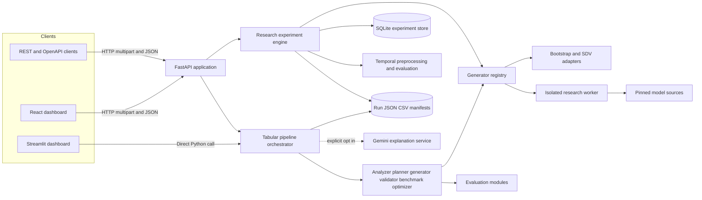
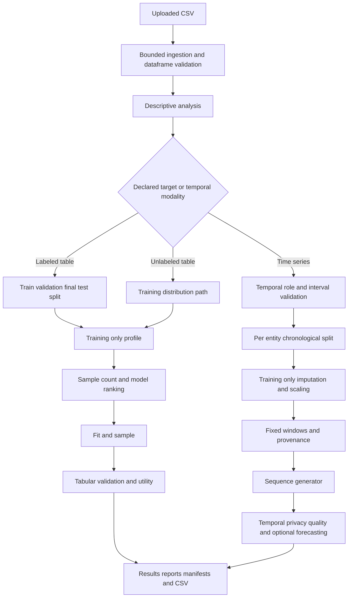
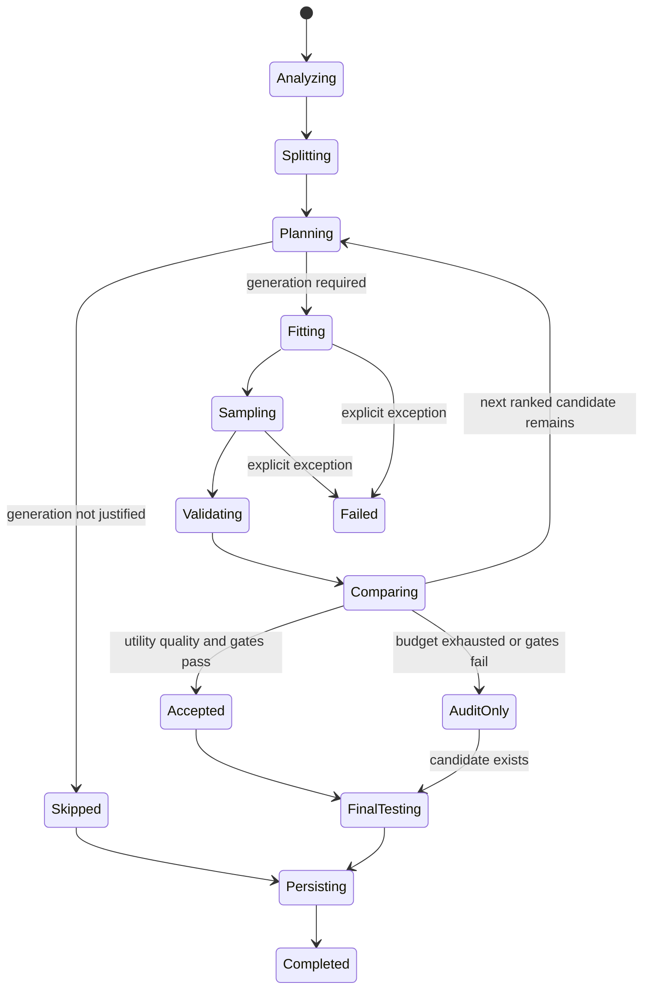
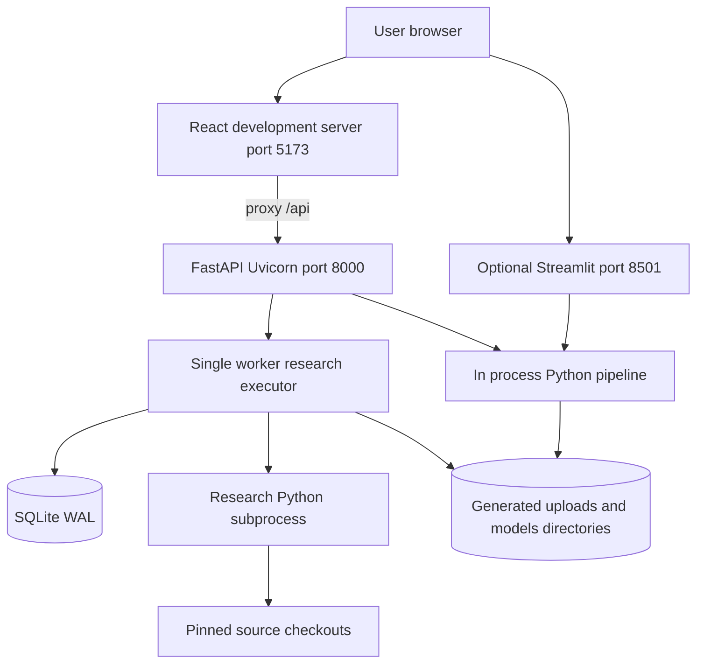
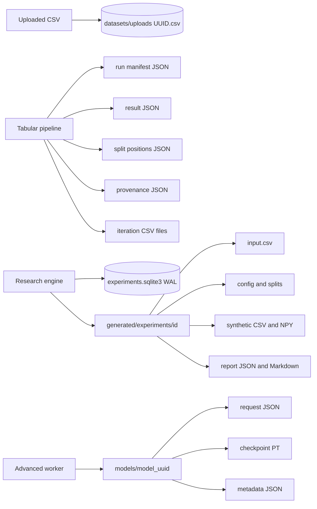
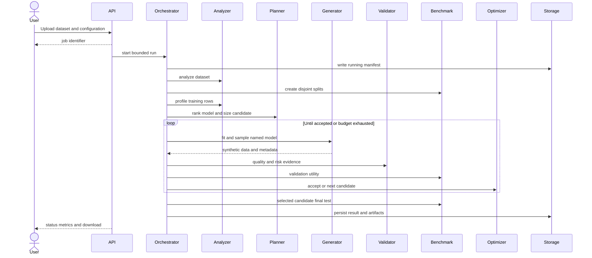
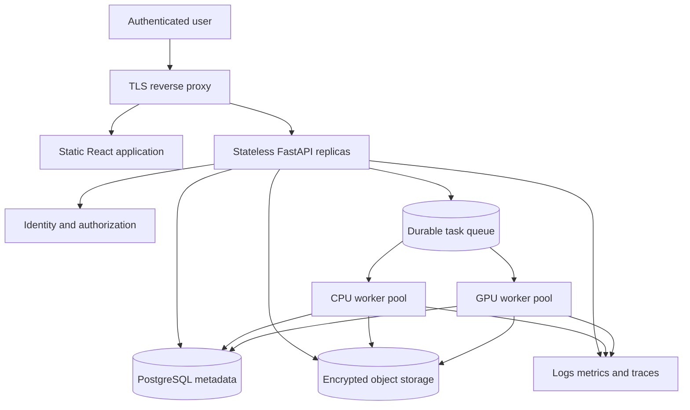

# Synthetic AI Platform Technical Project Report

**Project:** Advanced Multimodal Synthetic Data Generation and Evaluation Platform  
**Document type:** Final-year project report, research report, architecture specification, and engineering case study  
**Version:** 1.0  
**Current evidence date:** 23 November 2026  
**Implementation status:** Working single-machine research prototype with tabular and time-series generation, evaluation, experiment tracking, and a deterministic text baseline

This report explains the design, implementation, evaluation methodology, operating model, measured verification, limitations, and development roadmap of the Synthetic AI platform. The central result is a reproducible local system that can inspect a dataset, select compatible synthesis strategies, generate candidate data, evaluate quality and utility, enforce non-compensating risk gates, and retain the evidence required to audit a run. The platform is deliberately conservative about its claims: passing tests establishes software integration, while empirical similarity and privacy indicators do not establish anonymity, differential privacy, research-paper reproduction, or production readiness.

# 1. Executive Summary

## 1.1 Project overview

Synthetic AI is a modular platform for generating and evaluating synthetic tabular and multivariate time-series data. Its primary purpose is not merely to call a generative model. Instead, it implements the complete engineering workflow around synthetic-data research: data ingestion, schema analysis, data-leakage prevention, generator compatibility checks, dataset-aware planning, bounded candidate search, generation, statistical validation, downstream utility testing, empirical privacy analysis, artifact management, experiment tracking, and user-facing reporting.

The application supports three research modalities at different maturity levels. Tabular data is the most complete path and supports both labeled and unlabeled datasets. Time-series data has a separate schema and tensor lifecycle that respects timestamps, entities, chronological splits, fixed-length windows, and training-only preprocessing. Structured-to-text generation is present as a deterministic template and exact-rule consistency baseline; it is intentionally not represented as semantic natural-language generation. This separation prevents a row-oriented table contract from being incorrectly reused for temporal tensors or textual records.

The platform exposes its capabilities through a FastAPI backend, a React and TypeScript dashboard, an older Streamlit interface, and Python entry points. Baseline tabular models execute in the application process. Advanced TabSyn, Diffusion-TS, and TimeGAN-related work executes through isolated subprocess workers with pinned source revisions and persisted checkpoints. Temporal research jobs are recorded in a SQLite experiment store, while the original tabular pipeline persists JSON manifests and artifacts but still keeps active background-job state in process memory.

## 1.2 Problem statement

Organizations frequently need realistic data for model development, testing, demonstrations, research, and data-sharing workflows, but real data may be scarce, imbalanced, sensitive, temporally structured, or operationally difficult to distribute. A standalone generator does not solve this problem. A generated dataset can look plausible while copying training records, violating constraints, losing important relationships, degrading downstream accuracy, or leaking future information during evaluation. Different datasets also require different model families and generation volumes; a fixed model sequence or fixed synthetic-data ratio is technically unjustified.

The project therefore addresses a broader problem: how can a local platform select and execute an appropriate synthetic-data workflow while preserving model attribution, experimental discipline, measurable quality, and honest limitations? The answer implemented here is a bounded, evidence-driven orchestration layer around multiple real generators and evaluation methods.

## 1.3 Objectives

The project has six principal objectives:

1. **Support heterogeneous use cases.** Process labeled tables, unlabeled tables, and regular multivariate sequences without inventing a target column or forcing all data into one representation.
2. **Select models from evidence.** Rank installed, compatible generators using the observed training-data profile, execution device, conditional-generation requirements, and model cost.
3. **Prevent misleading results.** Preserve the requested and actual generator identity, fail explicitly, isolate final-test data from iterative selection, and distinguish accepted artifacts from audit-only candidates.
4. **Evaluate more than appearance.** Combine marginal fidelity, distributions, relationships, diversity, constraints, empirical privacy indicators, downstream utility, temporal dependence, and optional forecasting.
5. **Make research reproducible.** Record seeds, splits, configurations, source revisions, environments, checkpoints, timings, events, metrics, artifacts, and failures.
6. **Provide an understandable workflow.** Offer API documentation and dashboards that explain the state of a run, model availability, validation results, temporal schema choices, and download eligibility.

## 1.4 Key innovations

The project’s engineering contribution lies in the integration and controls surrounding the models:

- A dataset-aware tabular ranking policy replaces a predetermined generator warm-up order. The policy evaluates table size, numerical and categorical composition, imbalance, cardinality, skew, diversity, conditional requirements, device compatibility, dependency availability, and estimated model cost.
- Labeled search uses a three-way train, validation, and final-test discipline. Planning, preprocessing, and fitting use training rows; selection uses validation rows; the chosen candidate is evaluated once on untouched final-test rows.
- Generator failure is attributable. A failed CTGAN, TVAE, TabSyn, Diffusion-TS, or TimeGAN run never appears as a successful bootstrap result under the original model’s name.
- Critical privacy, validity, and distribution criteria are non-compensating gates. A high average score cannot conceal excessive exact copying or invalid output.
- Temporal preprocessing splits raw observations chronologically within each entity before imputation, scaling, or window construction. This avoids future leakage and prevents windows from crossing entity or split boundaries.
- Advanced research models run through a file-based worker boundary using pinned upstream commits, a separately provisioned Python overlay, tensor-only checkpoints, explicit timeouts, and structured metadata.
- The platform separates integration proof from quality claims. Tiny training tests and a small GPU smoke validate code paths, but the documentation does not treat them as evidence that a model is converged or globally superior.

## 1.5 Final outcomes

At the current evidence date, the repository contains 101 automated Python tests across 15 test modules, and the complete suite passes. The React production build also passes TypeScript checking and Vite compilation. Actual tiny fit, checkpoint reload, and sample paths have been exercised for TabSyn, Diffusion-TS, and the local `timegan_torch` implementation. Unified API smoke runs completed for both temporal neural models. The system includes a bundled time-series dataset, a guided temporal dashboard, fast model readiness checks, and a fresh-machine research provisioning script.

These outcomes establish a substantial educational and research prototype. They do not yet establish production scalability, formal privacy, full benchmark superiority, or multi-tenant security. The most important next engineering steps are durable queueing for all jobs, authentication and authorization, locked environments, production deployment of the React interface and research workers, retention controls, observability, and statistically rigorous multi-seed studies on licensed benchmark datasets.

# 2. Background and Context

## 2.1 Industry and research context

Modern data systems depend on representative datasets for application testing, analytics, model training, quality assurance, demonstrations, and scientific comparison. Access to real records is often constrained by privacy obligations, commercial sensitivity, low event frequency, class imbalance, fragmented ownership, or limited collection periods. Synthetic data attempts to reproduce useful statistical structure without directly distributing the original records.

The domain includes several model families. Statistical models such as Gaussian copulas are comparatively inexpensive and interpretable but may underrepresent complex nonlinear dependencies. Generative adversarial networks such as CTGAN are designed for mixed tabular data and minority modes but can be unstable and expensive. Variational autoencoders such as TVAE learn continuous latent representations but can smooth or blur multimodal distributions. Latent diffusion systems such as TabSyn shift denoising into a learned representation. Temporal models such as Diffusion-TS and TimeGAN explicitly model sequence dynamics that independent-row generators cannot preserve.

Synthetic-data quality is multi-dimensional. Marginal similarity alone cannot prove that relationships, constraints, utility, privacy, or temporal dependence are preserved. Likewise, downstream accuracy alone can hide exact memorization or invalid values. A useful platform must therefore treat synthesis as an experiment with explicit data roles, controls, gates, and retained evidence.

## 2.2 Existing solution categories

Existing approaches can be grouped into four categories:

| Category | Typical capability | Common limitation addressed by this project |
| --- | --- | --- |
| Model-specific libraries | Train and sample one or more generators | Limited end-to-end evaluation, selection discipline, and run auditability |
| Notebook-based research prototypes | Flexible experimentation | Difficult reproducibility, weak user workflow, ad hoc storage, and hidden environment assumptions |
| Commercial synthetic-data platforms | Managed generation and governance | Cost, closed implementation, external data transfer, and limited educational transparency |
| Simple augmentation scripts | Resample or perturb rows | False novelty, high copying risk, fixed ratios, and no model attribution or utility evidence |

The project uses SDV for several mature tabular synthesizers, but it does not assume that installing SDV creates a complete experimental system. It adds independent validation, downstream comparisons, adaptive planning, manifests, failure records, dashboards, temporal processing, and optional research workers. Similarly, it uses pinned upstream components for TabSyn and Diffusion-TS but records its adaptations rather than claiming an exact reproduction of the original training procedures.

## 2.3 Limitations of common approaches

Five recurring weaknesses motivated the architecture:

**Fixed model order.** Warming every model in the same sequence wastes resources and ignores dataset structure. A small numerical table, a mixed imbalanced table, and a long multivariate sequence have materially different requirements.

**Evaluation leakage.** Repeatedly selecting a generator from scores calculated on a final test set optimizes toward that test set. The resulting score is no longer an unbiased final estimate.

**False attribution through fallback.** If a failed advanced model silently returns bootstrap samples while reports retain the advanced model’s name, performance and provenance claims become invalid.

**Single-score reasoning.** A weighted average can hide unacceptable copying, invalid records, or a severe distribution mismatch. Some requirements must be treated as gates rather than compensating objectives.

**Environment ambiguity.** Research repositories frequently target different Python, PyTorch, CUDA, NumPy, or TensorFlow versions. Installing them directly into the application environment can break the working baseline and make results difficult to reproduce.

## 2.4 Why the project is necessary

The project is necessary as both an engineering system and an educational artifact. It demonstrates that synthetic-data research requires more than model code. The platform makes data roles explicit, separates modalities, exposes actual model availability, records source and environment facts, measures several notions of quality, and reports when a result is only suitable for audit. This combination supports final-year research, comparative experiments, portfolio demonstration, and future product development without concealing the gap between a prototype and a governed production system.

# 3. Problem Definition

## 3.1 Core problem

The core problem is to generate synthetic data that is useful enough for a declared purpose while managing fidelity, structural validity, privacy risk, computational cost, and experimental integrity. Formally, let a real training dataset be (D_{train}), a generator with configuration \(\theta\) be \(G_\theta\), and a synthetic dataset be \(\tilde D=G_\theta(D_{train})\). The platform seeks a candidate from a bounded set that performs well on a vector of measured objectives:

\[
\mathbf{J}(\tilde D)=
\left[
J_{fidelity},
J_{dependency},
J_{diversity},
J_{utility},
J_{privacy},
J_{validity},
-J_{cost}
\right].
\]

This is not reduced to unconstrained maximization. Privacy, exact-copy rate, validity, and minimum distribution similarity form hard acceptance conditions. The candidate set is also bounded by installed dependencies, modality, data type, conditional requirements, execution device, iteration count, and synthetic-row budget.

## 3.2 Business impact

If solved well, the platform can reduce the friction of producing datasets for prototyping and model experiments, make imbalanced-target augmentation measurable, allow safer demonstrations than distributing unrestricted raw data, and improve the auditability of synthetic-data decisions. If solved poorly, it can create false confidence: synthetic records may expose individuals, violate domain constraints, or reduce predictive performance. The project therefore treats audit evidence and honest rejection as valuable outcomes rather than forcing every run to appear successful.

## 3.3 Technical impact

The technical challenge spans data engineering, machine learning, software architecture, experiment management, and user experience. It requires heterogeneous preprocessing, model lifecycle abstraction, process isolation, deterministic configuration, split discipline, statistical tests, downstream models, asynchronous execution, persistence, and UI state. The architecture must allow new adapters without rewriting the orchestration core while still declaring capability and configuration differences explicitly.

## 3.4 User impact

The intended user should be able to answer the following questions without reading model source code:

- What kind of dataset did the platform detect?
- Which columns have which roles?
- Why was a generator selected, and which alternatives were eligible?
- How many rows or sequences will be generated, and why?
- Is the job queued, fitting, sampling, evaluating, completed, or failed?
- Did the result preserve distributions, relationships, utility, and temporal behavior?
- Did it exceed copying or constraint thresholds?
- Is the artifact eligible for intended use or retained only for audit?
- Which seed, configuration, source revision, and environment produced it?

The revised React interface turns the temporal path into a three-stage workflow: choose data, define and validate the schema, and then select, run, evaluate, and export a model.

## 3.5 Constraints

The current design operates under explicit constraints:

- The baseline is a local, single-machine platform rather than a distributed service.
- Public API ingestion is CSV-oriented; optional research ingestion can support Parquet where dependencies permit.
- Time-series models require regular intervals, numerical features, and fixed-length windows.
- Temporal context fields are retained as metadata but are not generated or used as model conditions.
- Advanced workers depend on separately provisioned Python and pinned source trees.
- The application environment may be CPU-only even when the host driver detects a GPU.
- Empirical privacy metrics do not provide a formal differential-privacy guarantee.
- Full multi-seed, publication-quality comparisons have not yet been performed.
- The platform has no current authentication, authorization, tenancy, cancellation, or distributed scheduling.

# 4. Project Goals and Requirements

## 4.1 Functional requirements

| ID | Requirement | Current implementation |
| --- | --- | --- |
| FR-01 | Accept and validate an uploaded table | Bounded CSV ingestion, schema checks, post-parse duplicate-column validation, minimum-row validation, and UUID storage |
| FR-02 | Support labeled and unlabeled tabular modes | Explicit or conservative target resolution; supervised and unsupervised evaluation branches |
| FR-03 | Analyze dataset structure and quality | Column types, semantic roles, missingness, duplicates, statistics, skew, cardinality, correlations, class distribution, and issue detection |
| FR-04 | Determine an adaptive generation count | Minority-target, small-dataset, low-diversity, and general-issue rules with per-iteration and cumulative caps |
| FR-05 | Select compatible generators from data properties | Capability filtering and explainable ranking in `app/agents/model_selector.py` |
| FR-06 | Fit and sample real generator implementations | Bootstrap, Gaussian Copula, CTGAN, TVAE, optional TabSyn, Diffusion-TS, and `timegan_torch` |
| FR-07 | Preserve generator identity on failure | Explicit exceptions and manifests; no hidden fallback substitution |
| FR-08 | Evaluate tabular quality and utility | Marginal, distribution, correlation, diversity, privacy, constraints, dependencies, MMD, discriminators, supervised or unlabeled utility |
| FR-09 | Protect final-test integrity | Training-only planning and transforms, validation-only selection, one final-test comparison |
| FR-10 | Process temporal datasets | Explicit timestamp, entity, feature, context, length, stride, interval, and missing-value schema |
| FR-11 | Run durable temporal experiments | SQLite experiment records, stage events, file artifacts, failure retention, and unified polling |
| FR-12 | Export results | Synthetic CSV, JSON results, reports, split manifests, metadata, and checkpoints where applicable |
| FR-13 | Explain results | Deterministic final reports and optional opt-in Gemini explanations |
| FR-14 | Expose graphical and programmatic interfaces | React dashboard, Streamlit interface, FastAPI/OpenAPI, and Python calls |
| FR-15 | Verify model readiness | Fast dependency/source inventory plus an explicit slower hardware probe |

## 4.2 Non-functional requirements

**Correctness.** Invalid targets, impossible splits, missing temporal roles, irregular sampling, infinite measurements, unsupported options, and unavailable models must fail explicitly. Generated outputs must match requested schema, shape, count, and finiteness expectations.

**Reproducibility.** Runs must record seeds, resolved configuration, dataset identity, row or window splits, environment versions, generator metadata, source revision, and artifacts. Random-number scopes must restore caller state. Bitwise GPU reproducibility is not promised because libraries and devices can introduce nondeterminism.

**Auditability.** A failed run must remain attributable to its requested model. Manifests and experiment records must expose stage, outcome, error, and limitations. Rejected candidates may remain available for inspection, but must be marked audit-only.

**Extensibility.** Adding a tabular generator should primarily require a lifecycle adapter and a registry entry rather than orchestrator changes. Modality-specific contracts are preferable to a misleading universal tensor type.

**Maintainability.** Configuration and public data structures use Pydantic validation. Functional areas are separated into `agents`, `generators`, `evaluation`, `pipeline`, `timeseries`, `research`, `text`, `api`, and frontend packages.

**Usability.** The system must provide understandable status, model availability, validation messages, defaults, and export actions. Labels and task-critical controls should remain readable, keyboard focus should be visible, and layouts should adapt to mobile widths.

## 4.3 Performance requirements

The prototype bounds several expensive dimensions:

- Default upload size is 20 MB, checked before full parsing.
- Main-pipeline search is limited to at most 50 iterations.
- Per-iteration generation defaults to at most 50% of original training rows.
- Cumulative generation defaults to at most 150% of original training rows.
- Advanced similarity evaluation uses a default sample cap of 500.
- Research adaptive selection permits at most eight explicit candidates.
- Temporal API output is limited to 100,000 sequences.
- Research subprocesses have a default timeout of 7,200 seconds.
- Advanced model operations are serialized through a lock and a single-worker research executor.
- Ordinary `/research/models` calls avoid importing PyTorch or probing CUDA unless explicitly requested.

These limits reduce accidental overload but do not constitute production resource governance. Temporal epochs, dimensions, and steps still need practical upper limits, and tabular background threads require a bounded executor.

## 4.4 Scalability requirements

The implemented target is one workstation. A production target would require:

1. Stateless API replicas behind a reverse proxy.
2. A durable task queue with separate CPU and GPU worker classes.
3. PostgreSQL or another shared transactional store for run metadata.
4. Object storage for datasets, checkpoints, reports, and generated artifacts.
5. Per-user ownership, quotas, scheduling, cancellation, retries, and retention.
6. Accelerator admission based on expected VRAM rather than HTTP concurrency.
7. Queue-depth and resource-aware autoscaling.

The present SQLite WAL database and single executor improve local durability and prevent resource contention; they do not provide horizontal scaling.

## 4.5 Security requirements

The current code enforces safe filenames, UUID upload paths, bounded reads, typed configuration, parameterized SQLite statements, subprocess argument arrays, pinned research commits, secret exclusion from manifests, and opt-in external explanations. Before deployment outside a trusted local environment, the following become mandatory requirements:

- Authentication and per-run authorization.
- Restricted CORS origins, TLS, and browser security headers.
- Rate limiting, quotas, bounded hyperparameters, and cancellation.
- Encryption at rest and in transit.
- Artifact retention, deletion, backup, and recovery policies.
- Sanitized public errors and protected detailed traces.
- Non-root, restricted worker containers and reviewed immutable dependencies.
- Secret management rather than local `.env` files.
- A threat-modeled privacy program and, where required, formal differential privacy.

# 5. System Architecture

## 5.1 High-level architecture

The system is a modular monolith with optional local worker subprocesses. The “multi-agent” label refers to cooperating deterministic Python components coordinated by an orchestrator, not to independently deployed autonomous services.



## 5.2 Component architecture

The backend has four principal layers. The interface layer contains FastAPI routes and the two dashboards. The orchestration layer contains the main pipeline and research experiment engine. The domain layer contains agents, model contracts, evaluators, temporal processing, and typed schemas. The infrastructure layer contains local files, SQLite, subprocesses, source provisioning, logging, and optional external model calls.

The main tabular path emphasizes adaptive application behavior and produces a `PipelineResult`. The research engine emphasizes durable experiments, explicit model comparison, checkpoint metadata, temporal tensors, and final reports. These paths share many validators and adapters but currently have different job durability. This duplication is an important architectural boundary and a future consolidation target.

## 5.3 Data flow architecture



Each transformation retains a clear evidence boundary. Original input is hashed. Labeled split row positions are persisted. Temporal windows retain source rows, timestamps, entities, and context. Scaling state is persisted for inverse transformation. Generator metadata records the actual model and configuration. Evaluation records both raw metrics and eligibility decisions.

## 5.4 Control flow architecture

The main pipeline implements a bounded feedback loop rather than an unbounded autonomous process. After the first dataset-ranked model is evaluated, the optimizer either accepts it, selects the next untried compatible model, or stops because the iteration, candidate, or row budget is exhausted. Final-test results cannot restart search.



## 5.5 Communication architecture

React uses a centralized API client and `fetch` to call `/api`; Vite proxies this path to port 8000 during development. Streamlit calls Python directly and therefore represents a separate runtime path. Internal components exchange pandas DataFrames and Pydantic data-transfer objects rather than messages over a broker. `AgentLog` entries provide a trace of orchestrated activity.

Advanced workers communicate through a deliberately simple file protocol. The parent writes training CSV or NumPy tensors and `request.json`, invokes `scripts/research_worker.py` with an argument list, and reads `checkpoint.pt`, `metadata.json`, and synthetic outputs. This is dependency isolation, not a security sandbox. The worker inherits local filesystem access and must therefore run only reviewed code in a trusted environment.

## 5.6 Deployment architecture



The Dockerfile creates a Python 3.12 image. Compose starts FastAPI and Streamlit with mounted `generated` and `datasets` directories. It does not build or serve React, configure a production reverse proxy, provide GPU passthrough, provision `.research` workers, persist the `models` directory, or harden the container. The current deployment description is therefore a local development topology, not a production reference architecture.

# 6. Technical Stack Analysis

| Technology | Selection rationale and integration | Advantages | Limitations and alternatives |
| --- | --- | --- | --- |
| Python 3.12 | Common runtime for API, orchestration, pandas, scikit-learn, SDV, and PyTorch workers | Mature ML ecosystem and rapid development | Some research repositories target older Python; worker isolation is required |
| FastAPI and Uvicorn | Typed multipart and JSON API with generated OpenAPI documentation | Concise routes, Pydantic integration, good local performance | CPU-bound training must not be treated as ordinary async web work; Django/DRF offers richer built-in administration and auth |
| Pydantic and Pydantic Settings | Validates settings, request-like configurations, schemas, and result contracts | Strong bounds, serialization, forbidden extra fields, `.env` integration | Environment variables are not a production secret manager |
| pandas and NumPy | Primary table and tensor preparation layer | Familiar, vectorized, compatible with ML libraries | In-memory operation limits dataset scale; Polars, Arrow, Spark, or distributed stores may be needed later |
| SciPy and scikit-learn | Statistical distances, splits, preprocessing, baseline models, metrics, forecasting | Mature, reproducible classical algorithms | Not a distributed experiment platform; estimators may require larger-memory copies |
| SDV | Supplies Gaussian Copula, CTGAN, and TVAE synthesizers | Tested metadata handling and mixed-table support | Conditional rejection may fail for rare conditions; exact behavior depends on locked versions |
| PyTorch | Advanced tabular and sequence workers | Flexible architectures, checkpoints, CPU and GPU support | Hardware-specific installation, CUDA compatibility, and nondeterminism require explicit management |
| SQLite with WAL | Durable local experiment status and event records | Zero-service setup, transactions, easy inspection | Single-machine store; unsuitable as a distributed queue or high-concurrency metadata service |
| React and TypeScript | Main interactive dashboard | Typed frontend state, reusable components, responsive experience | No router or persistent client state; production hosting and reverse proxy are not yet packaged |
| Vite | Development server, TypeScript build, static assets, `/api` proxy | Fast feedback and simple production build | Development proxy is not included in static production output |
| Tailwind CSS | Consistent dashboard styling and responsive utilities | Rapid UI development and small design-system surface | Long inline class lists can reduce component readability |
| Recharts and Lucide | Charts and accessible vector icons | Suitable for technical dashboards | Recharts contributes to the current bundle-size warning; lazy loading or lighter charts could reduce it |
| Streamlit and Plotly | Alternative scientist-oriented UI | Very fast Python-centric experimentation | Separate code path, limited production control, and different behavior from React |
| Google GenAI | Optional natural-language explanation layer | Improves accessibility of measured results when configured | External transfer, cost, latency, and privacy obligations; deterministic local fallback remains essential |
| Docker and Compose | Baseline local packaging | Reproducible Python service setup and shared mounts | Current image is not hardened and omits React, advanced workers, GPU, health checks, and production networking |

The stack was selected to balance educational transparency, availability of real synthesis models, and rapid iteration. Alternatives were not rejected universally; rather, they become appropriate at different maturity levels. For example, SQLite is superior to operating PostgreSQL for a single-user prototype, while PostgreSQL becomes necessary when metadata is shared across replicas. Likewise, filesystem artifacts simplify inspection today, while object storage is the appropriate production destination.

# 7. Detailed Workflow

## 7.1 Tabular upload and ingestion

**Input.** A client supplies a CSV file and, depending on the endpoint, an optional target, preferred generator, random seed, device, iteration budget, model parameters, split fractions, sensitive attribute, and explanation preference.

**Processing logic.** `app/api/main.py::_read_upload` requires a `.csv` suffix, rejects path separators, drive separators, and control characters in the client filename, and reads only the configured upload limit plus one byte. The default limit is 20 MB. The content is parsed through `load_csv_bytes`, column names are normalized, post-parse duplicate-column validation is applied, and the dataframe is validated for minimum dimensions. The server creates a UUID filename under `datasets/uploads` with exclusive creation rather than using the client filename as a path.

**Output.** The endpoint receives a pandas DataFrame and retains the original filename as descriptive metadata. A unique raw upload copy is stored locally.

**Failure conditions.** Unsupported suffix, unsafe filename, oversized content, invalid CSV, empty data, insufficient rows or columns, duplicate columns, and parser errors cause a client-visible failure before model execution.

**Validation mechanism.** File size is bounded before parsing, and storage containment is independent of user input. Tests exercise path-like filenames, duplicate uploads with the same visible name, and pre-parse size rejection.

## 7.2 Dataset analysis

**Input.** A validated DataFrame plus an explicit target, no target, or a request for conservative target detection.

**Processing logic.** `DatasetAnalyzer` identifies numerical and categorical columns; computes row and column counts, missing percentages, duplicate rates, unique counts, numerical mean, population standard deviation, minimum, maximum, and skew; records categorical distributions; calculates numerical correlations; assigns semantic types; and detects dataset issues. Target auto-detection recognizes a small list of names such as `target`, `label`, `class`, `churn`, and `outcome`. It never assumes that the last column is the target. A numerical target with more than 12 distinct values is treated as regression; other selected targets are treated as classification.

Issue rules identify missingness, duplicates, severe or moderate class imbalance, low diversity, strongly skewed numerical columns, mixed types, small datasets, and high-cardinality categorical columns. These are deterministic diagnostics, not LLM inferences.

**Output.** A typed `DatasetAnalysis` record containing statistics, roles, issues, target metadata, task type, class distribution, and relationship summaries.

**Failure conditions.** Empty data or an explicit target absent from the columns fails immediately.

**Validation mechanism.** API-facing numeric values are converted to finite JSON values. Unit tests cover target selection, alternate target names, conservative detection, semantic roles, and issue recognition.

## 7.3 Labeled split discipline

**Input.** The full DataFrame, a selected target, inferred task type, test fraction, validation fraction, and seed.

**Processing logic.** `BenchmarkAgent.research_split` first reserves final-test row positions. It then splits the remaining development positions into training and validation sets using a second deterministic seed. Classification uses stratification at both stages. The default test fraction is 0.25, and validation is 0.25 of the remaining development data, producing approximately 56.25% training, 18.75% validation, and 25% final test.

The full dataset analysis is retained for descriptive display, but the analyzer runs again on training rows to create `planning_analysis`. Generator ranking, sample planning, metadata discovery, constraints, and preprocessing therefore operate on training information. The row-position manifest is persisted before generation.

**Output.** Disjoint training, validation, and final-test dataframes and a split manifest containing original row positions and seed.

**Failure conditions.** Missing supervised targets, rare classes that cannot support the requested stratification, invalid fractions, or fewer than 10 training rows cause an explicit `BenchmarkError`. The implementation does not silently fall back to a non-stratified research split.

**Validation mechanism.** Tests verify disjointness, split persistence, training-only planning, stable task inference, and final-test isolation.

## 7.4 Sample-count planning

**Input.** Training-only `DatasetAnalysis` and optional explicit synthetic ratio.

**Processing logic.** `SamplePlanner` selects a mode. For imbalanced classification, it plans minority-only augmentation. For a small unlabeled or otherwise suitable dataset, it uses configured ratios. Healthy large datasets can skip generation. An explicit `PipelineConfig.synthetic_ratio` overrides general ratios but does not replace the specialized minority calculation.

For a minority class count \(N_{min}\), original training rows \(N\), and target population ratio \(r\):

\[
N_{desired}=\max\left(N_{min},\left\lceil N r\right\rceil\right),
\]

\[
N_{request}=N_{desired}-N_{min},
\qquad
N_{synthetic}=\min\left(N_{request},\left\lfloor N r_{iteration}\right\rfloor\right).
\]

The default severe-imbalance target ratio is 0.20, moderate target ratio is 0.40, small-dataset ratio is 0.50, low-diversity ratio is 0.30, general ratio is 0.20, and per-iteration cap is 0.50. The total search budget is capped at 1.50 times the original training population.

**Output.** `SampleCountDecision` and then a `GenerationPlan` containing requested count, target class where applicable, reason, ratio, cap evidence, and whether generation is justified.

**Failure conditions.** Invalid settings are rejected by configuration validation. A zero requirement can produce a legitimate “generation not needed” result rather than a fabricated run.

**Validation mechanism.** Fifteen sample-planner tests cover severe and moderate imbalance, caps, general augmentation, healthy-data skip decisions, and optimizer adjustment.

## 7.5 Dataset-aware model ranking

**Input.** Training analysis, generation mode, requested device, experimental-model setting, and optional preferred generator.

**Processing logic.** The registry first removes unavailable models, incompatible modalities, models without conditional support when minority generation is required, and models that cannot run on the requested device. The selector starts from transparent base scores—45 for Gaussian Copula, 40 for CTGAN, 35 for TVAE, 30 for TabSyn, and 5 for Bootstrap—and adjusts them from observed properties.

Small datasets favor Gaussian Copula and penalize neural models. Large tables favor CTGAN, TVAE, and TabSyn. Severe imbalance strongly favors CTGAN. Mixed types favor neural mixed-table models; numerical-heavy tables favor Gaussian Copula; categorical-heavy tables favor TVAE and CTGAN. High cardinality and numerical skew adjust the ranking again. CPU execution penalizes expensive neural models, while CUDA increases their relevance. Every adjustment is persisted as a reason rather than hidden in a black-box score.

**Output.** An ordered candidate list, scores, reasons, and a top-ranked `GenerationPlan`.

**Failure conditions.** Unknown models, disabled experimental models, missing dependencies, incompatible conditional sampling, and impossible device requests fail explicitly. A preferred generator does not bypass compatibility rules.

**Validation mechanism.** Tests prove that different dataset profiles can produce different orders and that new registry adapters can pass through the pipeline without hard-coded orchestrator edits.

## 7.6 Generator fit and sampling

**Input.** Real training data, an immutable `GeneratorConfig`, planned sample count, and optional conditional column and value.

**Processing logic.** `GeneratorAgent` creates the named adapter from the registry, validates it, and performs fit and sample operations under a serialized model lock. For minority augmentation, the condition is passed to an adapter that declares conditional support. SDV neural adapters use bounded rejection sampling rather than rewriting a generated target after the fact. TabSyn writes its request and training table to an isolated model directory and launches the research worker.

**Output.** A schema-aligned synthetic DataFrame with the requested row count plus generator metadata containing the actual adapter, configuration, schema, library or source version, device, and sampling details.

**Failure conditions.** Too few rows, invalid schema, infinite values, unsupported hyperparameters, invalid CTGAN batch size, unavailable CUDA, sampling exhaustion, out-of-memory, worker timeout, dirty or mismatched pinned source, malformed output, wrong count, or wrong shape all fail with the requested generator identity.

**Validation mechanism.** The generated table is checked against the training schema and count. Model lifecycle tests include explicit failure attribution and demonstrate that no implicit bootstrap substitution occurs.

## 7.7 Tabular validation

**Input.** Real training data and one generated candidate.

**Processing logic.** `ValidationAgent` calculates five equal-weight prototype scores: fidelity, distribution similarity, correlation similarity, diversity, and empirical privacy. It also evaluates discovered constraints, dependencies, RBF-kernel MMD, and a discriminator ensemble. The latter diagnostics are reported separately rather than silently altering the five-part average.

The overall score is:

\[
S_{overall}=\frac{S_{fidelity}+S_{distribution}+S_{correlation}+S_{diversity}+S_{privacy}}{5}.
\]

Default hard gates require overall validation of at least 0.55, privacy score of at least 0.70, exact-match rate of at most 0.05, constraint validity of at least 0.95, and distribution score of at least 0.60.

**Output.** A `ValidationResult` with raw component scores, pass state, detailed per-column evidence, constraint evidence, relationship diagnostics, and metric interpretation notes.

**Failure conditions.** Schema incompatibility or evaluation errors fail the candidate. Undefined diagnostics are represented as unavailable or null; they are not converted into perfect scores.

**Validation mechanism.** Known-signal and synthetic fixtures test fidelity direction, constraints, privacy, advanced similarities, discriminator behavior, and robustness to mixed data.

## 7.8 Labeled utility comparison

**Input.** Real training data, real validation data, synthetic records, target, task type, seed, and improvement thresholds.

**Processing logic.** The same downstream model and preprocessing design is trained once on real training data and once on real plus synthetic training data. Both are evaluated on identical held-out real validation rows. Classification uses macro F1 as the primary metric; regression uses \(R^2\). MAE and RMSE improvements reverse their sign so that a positive change always represents improvement.

Acceptance requires both a relative and absolute gain:

\[
\Delta_{relative}\ge 0.02
\quad\land\quad
\Delta_{absolute}\ge 0.01.
\]

After selection is frozen, the comparison is repeated once on final-test rows. The final result counts as improved only when validation and final-test requirements both pass alongside quality gates.

**Output.** Baseline and augmented metrics, per-metric changes, relative and absolute primary changes, threshold evidence, and evaluation role.

**Failure conditions.** Missing columns, target problems, invalid data transformations, or downstream training failures become `BenchmarkError` records.

**Validation mechanism.** Tests assert that iteration benchmarks are labeled `validation` and the selected final comparison is labeled `final_test`.

## 7.9 Unlabeled utility comparison

**Input.** Real training-distribution data and synthetic data with no target.

**Processing logic.** The system combines distribution, correlation, diversity, PCA structure, and K-nearest-neighbor real-versus-synthetic separability. If a discriminator AUC is 0.5, the datasets are difficult to distinguish. The similarity mapping is:

\[
S_{disc}=\operatorname{clip}\left(1-2|AUC-0.5|,0,1\right).
\]

This metric is not presented as target-prediction accuracy. It answers whether local neighborhoods can separate real from synthetic rows.

**Output.** `UnsupervisedUtilityResult` with component scores, KNN AUC, mapped similarity, pass state, and notes.

**Failure conditions.** Very small samples can make the KNN comparison unavailable. The result retains that state instead of fabricating a value.

## 7.10 Optimization and finalization

**Input.** Candidate results, ordered generator ranking, hard-gate failures, utility evidence, iteration count, and cumulative synthetic-row count.

**Processing logic.** If quality, utility, and hard gates pass, the optimizer stops before touching another model. Otherwise it advances to the next untried model in the dataset-specific order. Search stops at the configured iteration limit, candidate exhaustion, or total-row budget. The best gate-passing candidate is preferred. If none passes, the highest-scoring rejected candidate can be retained for audit with `artifact_eligible=false`.

For labeled data, the selected candidate receives one final-test comparison. Fairness is computed only when a sensitive attribute and classification target are both present. A provenance fingerprint and deterministic report are generated, and all terminal results are written to disk.

**Output.** `PipelineResult`, selected CSV path, result JSON, manifest, split file, provenance JSON, agent logs, and optional explanation text.

**Failure conditions.** If no synthetic candidate exists, the run is failed. An abrupt process termination can leave a tabular background job without durable active state even though completed artifacts and manifests are recoverable.

## 7.11 Time-series profiling and preprocessing

**Input.** CSV plus explicit timestamp, numerical feature list, optional entity, optional context, sequence length, stride, split fractions, missing policy, and interval tolerance.

**Processing logic.** Timestamps are parsed in UTC and data is grouped by entity. Every entity requires at least two strictly increasing distinct timestamps. The median interval is computed, deviations beyond tolerance are counted, and irregular data is rejected. Different entity intervals also cause rejection. Every entity is sorted and divided chronologically at the observation level before missing-value handling or scaling.

Training medians, minimums, and spans are calculated from training observations only. The selected missing policy is applied, and residual missingness or infinity causes failure. Normalization is:

For feature \(j\), define \(s_j=x_{max,train,j}-x_{min,train,j}\) when that difference is positive and \(s_j=1\) only for a constant training feature. Normalization is then:

\[
x'_j=2\frac{x_j-x_{min,train,j}}{s_j}-1.
\]

Windows are then created independently within each entity and split using the configured length and stride. Each window retains source rows, timestamps, entity, and context provenance.

**Output.** `PreparedSequences` with train, validation, and test tensors shaped `sequence × timestep × feature`, provenance lists, scaler state, interval, schema, and profile.

**Failure conditions.** Missing roles, overlapping roles, invalid timestamps, duplicate timestamps, irregular intervals, heterogeneous entity intervals, insufficient observations per split, nonnumeric features, infinite values, unsupported residual missingness, and training features that are entirely missing all fail before training.

**Validation mechanism.** The `/time-series/profile` route executes the real preprocessing logic and returns window shapes. Tests verify chronological separation, entity boundaries, training-only scaling, inverse transformation, round-trip export, and sample-dataset shapes.

## 7.12 Temporal training, evaluation, and export

**Input.** Training windows, sequence configuration, selected generator, sample count, optional forecast target, and durable experiment store.

**Processing logic.** `submit_experiment` creates a queued SQLite record, writes the input and configuration, and submits execution to a one-worker executor. The chosen adapter fits only chronological training windows. Candidate selection, when adaptive, uses validation windows and never final-test windows. The final temporal evaluation compares generated sequences with test windows.

Metrics include per-feature KS, normalized mean and variance error, autocorrelation error, trend error, power-spectrum Jensen–Shannon divergence, cross-feature lag dependence, uniqueness, train-versus-holdout distance privacy, and optional Ridge forecasting utility. Temporal gates limit exact and near training matches, average KS, and average ACF error.

Generated normalized tensors are inverse-transformed into physical units and exported with synthetic sequence identifiers and a configured timestamp origin. Context is not invented.

**Output.** SQLite status and events, input and split records, preprocessing JSON, model metadata, checkpoint, synthetic NumPy array, synthetic CSV, report JSON, report Markdown, previews, and metrics.

**Failure conditions.** Model, worker, checkpoint, shape, gate, evaluation, or export failures are captured with a structured traceback in the protected experiment record. Interrupted queued or running records can be marked failed by recovery; execution is not resumed automatically.

# 8. Algorithms and Methodology

## 8.1 Empirical bootstrap

The bootstrap adapter is a real algorithmic baseline, not a substitute presented under another name. It samples real training rows with replacement. For each numerical feature \(j\), it adds small Gaussian perturbation and clips the result to observed bounds:

\[
\tilde x_{ij}=\operatorname{clip}\left(x_{ij}+\epsilon_j,\min X_j,\max X_j\right),
\qquad
\epsilon_j\sim\mathcal{N}\left(0,(0.01\sigma_j)^2\right).
\]

Conditional mode first filters source training rows and then samples from that subset. Boolean and integer-like types are restored. The algorithm is fast, deterministic for a seed, and useful as a control. Its primary weakness is memorization: categorical combinations and much of each row originate directly from real data. Approximate generation complexity is \(O(md)\) for \(m\) rows and \(d\) columns.

## 8.2 Gaussian Copula

The Gaussian Copula adapter delegates implementation details to SDV. Conceptually, each variable’s marginal cumulative distribution \(F_j\) maps observations into latent normal coordinates:

\[
z_j=\Phi^{-1}(F_j(x_j)),
\]

where \(\Phi^{-1}\) is the inverse standard-normal CDF. A multivariate Gaussian dependence model is fit in latent space. Sampling draws \(\tilde z\) and applies inverse marginals:

\[
\tilde x_j=F_j^{-1}(\Phi(\tilde z_j)).
\]

The method is attractive for smaller tables because fitting and sampling are stable and comparatively inexpensive. It can preserve rank-like relationships and mixed marginals, but a Gaussian latent dependence structure may miss complex nonlinear or conditional modes. A dense approximation gives fitting cost near \(O(nd^2+d^3)\) and sampling cost near \(O(md^2)\), although actual SDV transforms and categorical handling determine observed cost.

## 8.3 CTGAN

CTGAN is used through SDV’s `CTGANSynthesizer`. It addresses mixed tabular distributions with conditional training and specialized transforms. Its adversarial foundation can be expressed as:

\[
\min_G\max_D
\mathbb{E}_{x\sim p_{data}}[\log D(x,c)]
+
\mathbb{E}_{z\sim p(z)}[\log(1-D(G(z,c),c))],
\]

where \(c\) represents a sampled category condition. Conditioning improves exposure to rare discrete modes. The platform exposes epochs, batch size, device, and seed and requires CTGAN batch size to be divisible by the default packing factor of 10. Strengths include mixed-data capability and minority conditioning. Weaknesses include training instability, computational cost, sensitivity to hyperparameters, and the possibility that conditional rejection still fails for poorly learned rare events. Complexity is dominated by epochs times batches times the generator and discriminator network costs.

## 8.4 TVAE

TVAE is also delegated to SDV. Its theoretical objective is a reconstruction term plus Kullback–Leibler regularization:

\[
\mathcal L_{VAE}
=
\mathbb E_{q_\phi(z\mid x)}[-\log p_\theta(x\mid z)]
+
\beta D_{KL}(q_\phi(z\mid x)\|p(z)).
\]

The encoder learns a distribution over latent variables and the decoder reconstructs table values. The smooth latent space can support stable sampling, but it may blur sharp or multimodal structures. The current adapter’s conditional behavior is SDV rejection sampling, not a conditional-VAE objective. Rare conditions can therefore exhaust the explicit `max_tries_per_batch` limit. The project increased the default bounded attempt budget from SDV’s common 100 to 1,000 but still fails rather than substituting another model.

## 8.5 TabSyn mixed-table codec

TabSyn uses a local training-only codec and pinned upstream neural components. High-cardinality numerical variables receive median imputation and a normal-output quantile transform. Numerical missingness is represented by an explicit Boolean categorical indicator. Categorical, Boolean, and low-cardinality columns use recorded vocabularies. Codec state is JSON-serializable, reversible, and retains column ordering and data types.

Quantile fitting is approximately \(O(d_n n\log n)\) for \(d_n\) numerical features. The encoded matrix requires \(O(n(d_n+d_c))\) storage. Unknown or invalid inverse values are handled by the explicit vocabulary and numeric inverse transforms rather than executable pickle preprocessing.

## 8.6 TabSyn VAE and latent diffusion

The worker first trains the upstream TabSyn VAE. Numerical outputs use mean squared error, categorical outputs use mean cross-entropy, and latent regularization uses a KL term:

\[
\mathcal L_{TabSynVAE}
=
MSE(\hat x_{num},x_{num})
+\frac{1}{C}\sum_{c=1}^{C} CE(\hat x_c,x_c)
-\frac{\beta}{2}\mathbb E[1+\log\sigma^2-\mu^2-\sigma^2].
\]

Encoder latents are flattened, centered, and divided by two according to the integration’s upstream normalization. A diffusion model then learns the latent distribution. Sampling applies the upstream denoiser for a configurable number of steps, restores the latent mean and scale, decodes numerical and categorical outputs, and performs codec inversion.

Default advanced parameters are 100 VAE epochs, 100 diffusion epochs, token dimension 4, hidden dimension 128, two layers, factor 8, 50 sampling steps, learning rate \(10^{-3}\), KL weight \(10^{-3}\), and one CPU thread. The checkpoint stores decoder weights, diffusion weights, and latent mean. Sampling reloads with `weights_only=True`.

The integration’s strengths are mixed-table support, source pinning, reversible preprocessing, process isolation, and real checkpoint reload. Its limitations are unconditional generation, a local fixed-epoch schedule, absence of the full upstream scheduler, and no claim of exact paper reproduction. Sampling cost is approximately \(O(mS C_{denoise})\), where \(S\) is the number of reverse steps.

## 8.7 Diffusion-TS

Diffusion-TS models a forward corruption process and learns its reverse. A standard diffusion step has the form:

\[
q(x_t\mid x_{t-1})=
\mathcal N\left(\sqrt{1-\beta_t}x_{t-1},\beta_t I\right).
\]

The pinned upstream `Diffusion_TS` network receives fixed sequence length, feature count, encoder and decoder layer counts, hidden dimension, attention heads, diffusion timesteps, and sampling timesteps. The worker invokes the upstream model loss, including its temporal and Fourier-aware behavior, and optimizes with Adam. The local loop deliberately omits the full upstream EMA and scheduler and records that adaptation.

`SequenceConfig` defaults to 100 epochs, batch size 32, hidden dimension 64, two layers, four heads, 500 diffusion timesteps, 50 sampling steps, learning rate \(10^{-4}\), and one thread. Hidden dimension must be even and divisible by the number of heads; sampling steps cannot exceed diffusion timesteps. Output must be finite and exactly shaped \([m,L,F]\).

Diffusion models can represent complex multi-scale temporal distributions and offer a stable likelihood-inspired training process, but reverse sampling is expensive and fixed-window handling does not provide arbitrary-length generation. Training complexity depends on epochs, number of windows, diffusion loss evaluations, attention width, and sequence length. Sampling is approximately \(O(mS C_{network})\).

## 8.8 TimeGAN PyTorch baseline

The local implementation contains five GRU-based subnetworks: embedder \(E\), recovery \(R\), generator \(G\), supervisor \(S\), and discriminator \(D\). A `RecurrentBlock` applies a GRU followed by linear projection; all networks except the discriminator use a sigmoid output.

Training has three phases. First, the embedding and recovery networks minimize reconstruction:

\[
\mathcal L_{reconstruction}=10\sqrt{MSE(R(E(X)),X)+\epsilon}.
\]

Second, the supervisor learns one-step latent dynamics:

\[
\mathcal L_{sup}=MSE(S(H)_{1:T-1},H_{2:T}).
\]

Third, joint training combines adversarial loss, supervised dynamics, and first/second moment matching:

\[
\mathcal L_G=
BCE(D(S(G(Z))),1)+BCE(D(G(Z)),1)
+100\sqrt{\mathcal L_{sup}+\epsilon}
+100\mathcal L_{mom},
\]

\[
\mathcal L_{mom}=
\|\mu_X-\mu_{\tilde X}\|_1+
\|\sigma_X-\sigma_{\tilde X}\|_1.
\]

The joint embedder objective is:

\[
\mathcal L_{E,joint}=
10\sqrt{MSE(R(E(X)),X)+\epsilon}+0.1\mathcal L_{sup}.
\]

Two generator/embedder updates occur per discriminator pass. The discriminator only steps when its loss exceeds 0.15. For sequence length \(L\), feature width \(F\), and hidden width \(H\), a GRU pass is approximately \(O(LH(H+F))\) per sample, multiplied by subnetworks and training phases.

The implementation is a faithful comparative baseline in objective structure, but it is a fixed-window PyTorch reimplementation, not a port of TensorFlow checkpoints or a bitwise reproduction of the original implementation.

## 8.9 Window bootstrap control

The temporal bootstrap selects normalized training windows exactly with replacement. Its time and copy complexity are \(O(mLF)\). It is intentionally expected to fail exact-copy privacy gates and serves as a control that demonstrates whether the evaluation can identify memorization. It should not be described as a safe generative model simply because it produces correctly shaped arrays.

## 8.10 Tabular fidelity and distribution metrics

For a numerical feature, fidelity is based on the two-sample Kolmogorov–Smirnov statistic:

\[
S_{KS}=1-D_{KS}.
\]

Categorical fidelity uses total variation distance:

\[
TV(P,Q)=\frac{1}{2}\sum_k|p_k-q_k|,
\qquad
S_{cat}=1-TV(P,Q).
\]

Numerical distribution similarity also reports normalized Wasserstein behavior:

\[
S_W=\frac{1}{1+W_1(X,\tilde X)/\max(\sigma_X,\epsilon)}.
\]

Additional evidence includes quantile error, histogram overlap, categorical Jensen–Shannon divergence, and category coverage. These measurements reveal different failure modes; no single marginal metric proves joint fidelity.

## 8.11 Dependency, diversity, and discriminator metrics

Numerical correlation similarity is approximately:

\[
S_{corr}=1-\operatorname{mean}_{i<j}|\rho^{real}_{ij}-\rho^{synthetic}_{ij}|.
\]

Advanced dependency checks also compare Spearman correlation, Cramér’s V for categorical pairs, and correlation ratio for mixed pairs. Diversity averages unique-row ratio, original-category coverage, and original numerical-range coverage.

The RBF-kernel maximum mean discrepancy is:

\[
MMD^2=
\mathbb E[k(X,X')]+\mathbb E[k(Y,Y')]-2\mathbb E[k(X,Y)].
\]

The kernel bandwidth uses a median-distance heuristic. Because kernel matrices are quadratic, samples are capped by default at 500. A logistic-regression, random-forest, and histogram-gradient-boosting ensemble attempts to distinguish real from synthetic records. AUC is mapped to similarity using the discriminator equation given earlier. AUC near 0.5 is desirable, but can also occur when both datasets are poor or the test lacks power; it must be interpreted alongside other metrics.

## 8.12 Privacy and constraint methodology

The main tabular privacy score is a transparent prototype indicator:

\[
S_{privacy}=1-0.7r_{exact}-0.3r_{near}.
\]

The research engine additionally compares synthetic-to-training and synthetic-to-holdout distances and computes a membership-style distance attack AUC. Sample counts are capped at 128 to bound pairwise work. These values describe empirical exposure under a particular distance representation. They do not provide \((\epsilon,\delta)\)-differential privacy or guarantee that an adversary cannot infer membership.

Constraint discovery captures observed numerical bounds, integer-only behavior, non-negativity, unit intervals, constant columns, datetime ranges, and finite categorical vocabularies. Validation measures violations; it does not silently repair generated output. This preserves the distinction between model quality and post-processing.

## 8.13 Temporal metrics

For each feature, the temporal evaluator reports flattened-marginal KS, normalized mean error, normalized variance error, trend error, autocorrelation error, and power-spectrum Jensen–Shannon divergence. Autocorrelation is evaluated for lags 1 through \(\min(10,\lfloor L/4\rfloor)\). Lag-zero and lag-one cross-feature correlation differences measure multivariate temporal dependence. The exact unique-sequence ratio reveals repeated arrays.

Approximate complexity is \(O(FN\log N)\) for sorted marginal comparisons, \(O(FWL\ell)\) for ACF across \(\ell\) lags, \(O(FWL\log L)\) for FFT spectra, and \(O(F^2WL)\) for cross-feature dependence. Constant signals can make a metric undefined; the evaluator returns null rather than claiming perfect preservation.

## 8.14 Forecasting methodology

When a forecast target and horizon are configured, a fixed Ridge model with \(\alpha=1\) flattens prefix windows and predicts the requested future target. Real-only, synthetic-only, and augmented training sets are evaluated on the same chronological held-out windows. MAE and RMSE are restored to original physical target units using the training span. This fixed estimator controls downstream-model variation, but it measures one forecast task rather than universal temporal usefulness.

## 8.15 Selection methodology and complexity

The active main pipeline uses explainable model ranking followed by early stopping. The research engine also supports a bounded adaptive selector. Candidates are evaluated on validation data. Gate-passing candidates are preferred; failed trials remain recorded. A Pareto frontier treats validation score as increasing and measured fit-plus-sample cost as decreasing. The selected frontier candidate maximizes:

\[
J_{select}=S_{validation}-\lambda\frac{C}{\max C_{frontier}},
\]

with default cost weight \(\lambda=0.05\). Frontier construction is \(O(K^2)\), but \(K\le 8\), so model training dominates computation. The bounded search does not establish global optimality.

# 9. Data Pipeline

## 9.1 Data sources

The platform accepts user-supplied CSV files and includes labeled customer, unlabeled customer, backward-compatible churn, and multivariate sensor samples. The sensor sample contains an hourly `timestamp`, `machine_id` entity, `temperature_c`, `vibration_mm_s`, and `pressure_kpa` signals, and `machine_type` context. Candidate public research datasets are discussed in `EXPERIMENT_PLAN.md`, but the system does not download them automatically because source, license, version, hash, target, units, and entity semantics must be reviewed first.

## 9.2 Collection and ingestion

Collection remains outside the application. The platform assumes that a user has authority to process the supplied dataset. Ingestion validates transport-level and structural properties but does not establish consent, lawful basis, de-identification, label correctness, or source provenance. Those responsibilities must be part of a production data-governance process.

## 9.3 Preprocessing

Tabular adapters use training-only metadata and transforms. SDV constructs metadata from data types and semantic decisions. Downstream models use median imputation and standard scaling for numerical columns, most-frequent imputation and one-hot encoding for categorical columns. TabSyn uses the reversible mixed-table codec described earlier. Temporal preprocessing uses chronological split-before-transform and training-only medians and min/max spans.

## 9.4 Validation and transformation

Input validation rejects malformed tables, duplicate columns, infinity, and unsupported configurations. Generator output is aligned to the training schema and validated for count and type. Temporal tensors are checked for rank, minimum number of windows, length, feature count, and finiteness. Export inverse-transforms temporal values and creates synthetic sequence identifiers rather than reusing real entity identifiers.

## 9.5 Storage mechanisms



All current storage is plaintext local filesystem storage. The same sensitive dataset can exist in uploads, an experiment input directory, and an advanced model directory. No deletion API, retention schedule, encryption layer, or access-control boundary currently governs these copies.

## 9.6 Data flow across services

In React development, the browser sends multipart data to `/api`, Vite proxies to FastAPI, and FastAPI either starts a daemon tabular thread or submits a durable research experiment. Streamlit bypasses HTTP and calls Python directly. Advanced workers receive file paths rather than serialized RPC payloads. The optional explanation path may send truncated analysis and result summaries to Google only after explicit enablement and key configuration; numerical decisions remain local.

# 10. Model Design

## 10.1 Model portfolio design

The portfolio deliberately spans simple statistical controls, mature library models, advanced diffusion research integrations, and explicit copying baselines. This diversity makes it possible to ask whether an expensive model actually improves measured outcomes relative to a cheaper alternative.

| Model | Modality | Training implementation | Conditional support | Intended role |
| --- | --- | --- | --- | --- |
| Bootstrap | Tabular | Local empirical sampler | Filtered source subset | Cheap baseline and diagnostic |
| Gaussian Copula | Tabular | SDV in process | SDV condition | Stable statistical baseline |
| CTGAN | Tabular | SDV in process | Conditional/rejection mechanisms | Mixed and imbalanced tables |
| TVAE | Tabular | SDV in process | Rejection sampling | Latent neural baseline |
| TabSyn | Tabular | Isolated PyTorch worker | No | Experimental latent diffusion |
| Diffusion-TS | Time series | Isolated pinned PyTorch worker | No | Advanced fixed-window synthesis |
| `timegan_torch` | Time series | Isolated local PyTorch worker | No | Comparative adversarial baseline |
| Window bootstrap | Time series | Local exact resampling | No | Copy-risk control |

## 10.2 Training methodology

All generation models fit only training data. Tabular main-pipeline candidates are selected from validation utility and quality. Temporal research candidates are selected from validation windows. Model-specific seeds are recorded, and worker execution scopes Python, NumPy, and PyTorch randomness. CUDA requests fail when unsupported rather than silently switching unless the caller explicitly selected `auto`.

No automatic out-of-memory tuning occurs. Batch size, model size, precision, and schedule changes materially alter an experiment and must be recorded as a separate configuration. Advanced checkpoints are saved after fit and reloaded for a distinct sampling operation, which tests more than in-memory inference.

## 10.3 Hyperparameters

The main typed hyperparameters include epochs, batch size, device, seed, model dimensions, layer counts, attention heads, diffusion timesteps, sampling steps, learning rate, sequence length, stride, sample count, forecast horizon, and selection mode. Pydantic bounds reject negative or inconsistent values. The React temporal UI presents common options and hides advanced dimensions in a disclosure panel.

Prototype defaults are intentionally small enough to be configurable but are not asserted to be optimal. Smoke tests may use one epoch and tiny dimensions solely to verify software integration. Research conclusions require prespecified full schedules and multiple paired seeds.

## 10.4 Optimization methods and losses

SDV controls its installed CTGAN and TVAE optimizers. TabSyn uses Adam for both VAE and diffusion stages. Diffusion-TS uses Adam over the upstream loss. TimeGAN uses separate Adam optimizers for embedding/recovery, generation/supervision, and discrimination. The platform checks every locally visible neural loss for finiteness and fails on NaN or infinity.

The optimization layer above the models is not gradient-based. It is a bounded search across ranked candidates and sample counts, controlled by validation evidence, hard gates, cost, and resource compatibility.

## 10.5 Evaluation metrics

Tabular evaluation covers marginal and distribution similarity, linear and nonlinear dependence diagnostics, diversity, empirical privacy, constraints, discriminators, supervised utility, unlabeled similarity, optional fairness, and efficiency. Temporal evaluation covers marginal, moment, ACF, trend, spectral, cross-variable, uniqueness, distance privacy, forecasting, and efficiency. Each metric includes an interpretation boundary. No composite score is treated as a universal definition of quality.

## 10.6 Experiment setup

A valid comparative study should fix dataset version and hash, split seed, generator seeds, sample count or resource budget, preprocessing, downstream estimator, metrics, and failure handling. The repository’s `ExperimentConfig` stores modality, generator, target, sensitive attribute, count, seeds, model configuration, temporal schema, forecast task, selection mode, candidates, ablation label, experimental opt-in, cost weight, and temporal gates.

The research engine writes configuration before fitting and terminal state after completion or failure. It records environment packages, fit and sampling wall time, throughput including worker startup, model bytes, and peak PyTorch GPU allocation when available. CPU peak memory remains null rather than estimated.

# 11. Multi-Agent System Design

## 11.1 Meaning of agent in this project

An agent is a deterministic component with a defined responsibility, typed inputs, typed outputs, decision logic, and error behavior. The components are coordinated by `run_pipeline`; they are not separate network services and do not negotiate with one another. This design resembles an orchestrator-mediated blackboard: the orchestrator passes DataFrames and Pydantic records and accumulates `AgentLog` entries.

## 11.2 Agent responsibilities

| Agent | Inputs | Outputs | Decision logic | Error handling |
| --- | --- | --- | --- | --- |
| Dataset Analyzer | DataFrame and target policy | `DatasetAnalysis` | Deterministic type, statistic, target, role, and issue inference | Rejects empty data and unknown targets |
| Sample Planner | Training analysis | `SampleCountDecision` | Minority, small-data, diversity, issue, cap, or skip rules | Bounded numeric decisions; invalid settings fail validation |
| Generation Planner | Analysis, device, preference, config | `GenerationPlan` | Capability filtering and dataset-aware scoring | Fails unknown, unavailable, incompatible, or unsupported models |
| Generator Agent | Training data and plan | Synthetic DataFrame and metadata | Registry factory, fit, optional condition, sample | Preserves actual model identity and wraps explicit failure |
| Validation Agent | Real training and synthetic data | `ValidationResult` | Five-part score plus constraints and advanced diagnostics | Reports unavailable evidence instead of fabricating success |
| Benchmark Agent | Real train, held-out real data, synthetic data | `BenchmarkResult` | Same model comparison and dual improvement thresholds | Raises on split, target, schema, or training errors |
| Optimization Agent | Candidate evidence and budgets | `OptimizationDecision` | Early accept or next ranked untried candidate | Stops at candidate, iteration, or row budget |
| LLM Reasoner | Aggregate measured JSON | Explanation text | Explains existing facts only when enabled | Uses deterministic fallback on missing key or service failure |

## 11.3 Agent sequence



## 11.4 Communication and consistency

Typed schemas reduce ambiguity between components. The planner cannot return an arbitrary model name without registry validation. The generator returns metadata that identifies the actual implementation. Validation and benchmark records carry their evaluation role. The optimizer receives explicit hard-gate failures instead of inferring them from prose. This structure makes decisions inspectable and testable.

## 11.5 Error propagation

Expected domain errors derive from `SyntheticAIError` categories such as invalid dataset, generator, benchmark, and pipeline errors. API routes translate these into appropriate client errors. Tabular run manifests record failure type and message and attach the run ID to propagated exceptions. The research engine records full traceback in its local protected record. Production APIs should expose sanitized errors while retaining the detailed trace only for authorized operators.

# 12. Codebase Structure

## 12.1 Repository layout

```text
edai7_v1.0/
├── app/
│   ├── agents/          # Analysis, planning, generation, validation, benchmarking, optimization
│   ├── api/             # FastAPI routes, upload boundaries, job polling, downloads
│   ├── evaluation/      # Fidelity, diversity, privacy, constraints, utility, fairness, similarity
│   ├── generators/      # Lifecycle contract, registry, SDV, bootstrap, TabSyn adapter
│   ├── models/          # Downstream benchmark estimator abstraction
│   ├── pipeline/        # Main orchestrator, selection helpers, candidates, reporting
│   ├── research/        # Experiment config, durable store, source pins, planning and evaluation
│   ├── schemas/         # Pydantic DTOs for public and internal results
│   ├── text/            # Deterministic template and exact-rule consistency baseline
│   ├── timeseries/      # Temporal schema, preprocessing, sequence adapters, TimeGAN model
│   └── utils/           # CSV handling, semantic inference, logging, samples, exceptions
├── frontend/
│   ├── src/             # React app, pages, temporal studio, components, API client and types
│   └── dashboard.py     # Streamlit alternative interface
├── scripts/             # Research setup, worker, time-series smoke and AST generator
├── tests/               # Unit and integration suite by subsystem
├── datasets/            # Bundled samples and ignored uploads
├── generated/           # Ignored run and experiment artifacts
├── models/              # Ignored advanced checkpoints and worker files
├── requirements*.txt    # Baseline and minimal research-overlay dependencies
├── Dockerfile
├── docker-compose.yml
└── architecture, setup, milestone and experiment documentation
```

## 12.2 Design patterns

**Registry and Factory.** `app/generators/registry.py` maps a stable model name to a factory, dependency, capability record, availability check, and documentation. `create_generator` validates that a constructed adapter implements the declared lifecycle and identity.

**Adapter.** `SDVGenerator`, `TabSynGenerator`, and sequence adapters present consistent operations over different libraries and process boundaries. The adapters translate general configuration into model-specific setup and return common metadata.

**Strategy.** The selected generator and labeled or unlabeled evaluation mode are interchangeable strategies chosen from data characteristics and declared capabilities.

**Orchestrator.** `app/pipeline/orchestrator.py` coordinates agents, enforces ordering, owns the feedback loop, controls final-test access, and composes the result.

**Repository.** `ExperimentStore` hides SQLite connection details and artifact-directory lookup behind create, get, update, event, list, recovery, and directory operations.

**Data Transfer Object.** Pydantic models in `app/schemas/schemas.py`, `app/generators/base.py`, `app/research/config.py`, and `app/timeseries` define immutable or validated boundaries.

**Template Method.** `SDVGenerator` contains common fit, sample, validation, device, error, and metadata behavior; concrete Copula, CTGAN, and TVAE adapters specify identity and synthesizer class.

**Process isolation.** Advanced models exchange files with `research_worker.py`, allowing a separately provisioned runtime and pinned sources without embedding their command-line dataset loaders in the application.

## 12.3 Dependency relationships

The API depends on schemas, configuration, utilities, the tabular pipeline, and research engine. The tabular orchestrator depends on agents, evaluation modules, generator registry, benchmark models, and reporting. Agents depend on typed schemas and domain utilities but do not depend on the frontend. Research code reuses the generator registry and validators and adds durable experiment state. The frontend depends only on HTTP contracts represented in TypeScript.

The direction is mostly inward toward domain abstractions. One area of coupling remains: the research engine imports `_hard_gate_failures` from the main orchestrator. Moving gates into a dedicated policy module would remove this private-function dependency and help unify the two execution paths.

## 12.4 Configuration management

`Settings` reads defaults, `.env`, and environment variables. Pydantic bounds validate upload size, iterations, seeds, split fractions, ratios, evaluation caps, thresholds, paths, logging level, and experimental feature flags. Run-level dataclasses and Pydantic models allow explicit overrides while keeping global defaults visible.

Configuration precedence is generally request/run configuration over environment settings over code defaults. The resolved values are persisted with a run. The Gemini API key is deliberately excluded. The current Python requirement file uses minimum versions instead of an exact lock, so a fresh environment is not guaranteed to match the audited installation. The frontend lockfile improves Node reproducibility even though `package.json` still uses several `latest` declarations.

## 12.5 Frontend structure

`App.tsx` holds central tabular workflow state and selects page components without a URL router. `api/client.ts` defines the backend calls. `types/api.ts` mirrors result structures. `pages.tsx` contains the tabular overview, dataset, generation, validation, benchmark, optimization, and result views. `time-series-page.tsx` owns a dedicated guided temporal state machine. Shared cards, buttons, status pills, metrics, layout, and charts live under `components`.

The architecture is sufficient for the current prototype, but reloading loses UI state and a large `pages.tsx` increases maintenance cost. Future work should introduce route-based navigation, queryable run URLs, persisted selected job IDs, lazy page loading, and smaller feature modules.

# 13. Implementation Details

## 13.1 API module

`app/api/main.py` creates the FastAPI application, permissive development CORS, process-local tabular job dictionaries, the durable experiment store, and all route handlers. Important helpers include:

- `_target_options`, which distinguishes no target, explicit target, and `__auto__`.
- `_read_upload`, which enforces the ingestion boundary and UUID storage.
- `_preview_records`, which converts NaN and infinite values into JSON-safe previews.
- `_column_list`, which accepts JSON arrays or comma-separated temporal role values.
- `_time_series_schema`, which creates the typed temporal contract.
- `_temporal_job_payload`, which maps a durable experiment record into the unified polling response.

`POST /pipeline-runs` branches on modality. Tabular jobs run in daemon threads and update `PIPELINE_JOBS`. Temporal jobs validate preprocessing synchronously, verify model readiness, build `ExperimentConfig`, and submit to the durable research engine. `GET /pipeline-runs/{id}` first checks the wrapper dictionary and then consults SQLite for temporal records. The response contract therefore appears unified even though underlying durability differs.

## 13.2 Analyzer implementation

`DatasetAnalyzer.analyze` is intentionally deterministic. It uses pandas type inspection and helper semantic inference rather than model-generated guesses. Numerical statistics use population standard deviation for display and replace non-finite API values with zero. Categorical distributions are limited to the 20 most common values. Correlations are numerical Pearson correlations with non-finite values replaced. Issue detection is threshold-based and records both a stable key and a human-readable explanation.

The target resolver favors explicit user intent. Conservative automatic detection checks exact case-insensitive names from a fixed list. This avoids the common but dangerous practice of treating the final column as a label.

## 13.3 Generator registry and runtime

`GeneratorCapabilities` describes family, modalities, supported data types, input shape, missingness policy, preprocessing, CPU/GPU support, conditional method, cost, experimental status, options, and execution mode. Availability checks avoid importing optional heavy libraries where possible.

`seeded_execution` scopes Python, NumPy, and PyTorch random states and restores the caller’s prior state. `resolve_device` validates `cpu`, `cuda`, and `auto` against model capability and actual CUDA support. A model lock serializes fit and sample work, reducing shared RNG and accelerator contention. This supports local reproducibility but also limits concurrency.

## 13.4 SDV implementation details

`sdv_common.py` creates metadata and classifies columns conservatively, removes unsafe automatic primary-key assumptions, normalizes object values, fits the installed synthesizer, applies a sampling seed, and restores output types. `SDVGenerator.fit` rejects advanced diffusion configuration and neural parameters for non-neural models. Neural models default to 100 epochs and batch size 500 unless overridden. The adapter examines the installed SDV constructor for a supported GPU parameter rather than assuming one name.

Sampling validates conditions against fitted columns. Conditional requests use an explicit maximum attempts budget. Any out-of-memory error is rephrased to require an explicit smaller configuration; the system never silently mutates the experiment. Metadata includes the SDV version, resolved configuration, sampling configuration, schema, and determinism limitation.

## 13.5 TabSyn worker implementation

`TabSynGenerator.fit` creates a unique model directory, writes training data and a complete request, verifies the pinned source, and launches the worker. The worker imports only selected upstream network, diffusion, and sampling modules rather than running the upstream CLI or dataset loaders. It saves codec state as JSON and model state as tensors. `load` verifies that the current source revision matches the request and that the checkpoint exists.

Worker metadata includes generator, commit, license, configuration, device, training seconds, final batch losses, PyTorch peak allocation where applicable, checkpoint bytes, worker environment, and a plain statement of adaptations. This evidence makes it possible to distinguish the integrated implementation from an unmodified paper reproduction.

## 13.6 Temporal data implementation

`TimeSeriesSchema` is immutable and rejects overlapping role assignments. `profile_sequences` validates temporal columns, parses UTC timestamps, calculates entity interval diagnostics, and describes missingness and context policy. `prepare_sequences` adds a reserved source-row column, performs stable time sorting, creates raw chronological partitions, computes training statistics, applies policy, normalizes, constructs windows, and records provenance.

The train, validation, and test dictionaries contain independent NumPy arrays. `inverse_sequences` restores units. `sequences_to_frame` creates a flat CSV representation with a synthetic entity or `synthetic_sequence_id` and generated timestamps. Because a generated sequence has no authentic original context, context is omitted rather than copied or fabricated.

## 13.7 Sequence adapter implementation

`SequenceGenerator` persists `training.npy`, request metadata, and then launches fit and sample operations in the chosen research interpreter. It accepts at least two finite windows with length at least eight. The subprocess timeout defaults to two hours. A completed sample operation must produce a finite array with the exact requested shape. `load` verifies source revision and checkpoint.

`TimeGANGenerator` changes only the worker model name, reusing the persistence and subprocess contract. `WindowBootstrapGenerator` is local, CPU-only, and records that model size and GPU allocation are unavailable.

## 13.8 Research experiment implementation

`ExperimentStore` initializes SQLite in WAL mode, records each experiment as a JSON payload, and creates a directory keyed by a UUID. Updates merge payload fields transactionally, while `event` appends timestamped stage messages. Directory access first requires a real database record, which prevents using arbitrary identifiers as paths. Recovery marks stale queued or running work as interrupted and failed.

The global research executor has one worker. `submit_experiment` creates the record and writes the input before scheduling. `execute_experiment` records running state, stages, wall time, environment, completion metrics, or structured failure. It writes both machine-readable JSON and a concise Markdown report.

Tabular research experiments support TRTR, TSTR, augmented utility, empirical privacy, fairness prerequisites, and explicit, rule, or adaptive candidate selection. Temporal experiments support sequence metrics, privacy controls, optional forecasting, inverse export, previews, and temporal gates.

## 13.9 Downstream benchmark implementation

`DownstreamModel` builds a `ColumnTransformer`: numerical fields receive median imputation and standard scaling; categorical fields receive most-frequent imputation and one-hot encoding with unknown-category handling. The default classifier or regressor is a 150-tree random forest with `min_samples_leaf=2`; the model suite can also evaluate logistic regression or Ridge and histogram gradient boosting.

Classification reports accuracy, macro precision, macro recall, macro F1, and binary ROC-AUC when available. Regression reports MAE, RMSE, and \(R^2\). Macro metrics avoid allowing a majority class to dominate the primary comparison.

## 13.10 Reporting and provenance

The reporting module creates a structured payload and deterministic natural-language summary. Optional Gemini receives already measured summaries only when enabled; its output does not replace metrics. Provenance calculates a metadata fingerprint over generated content and generator context. It supports lineage and accidental-change detection but is not a robust invisible watermark or cryptographic proof of origin.

## 13.11 React temporal user experience

The temporal page implements a guided state progression. Loading a sample or file detects likely roles. Timestamp and entity use labeled selects with inset chevrons. Feature and context selection uses clickable chips rather than a Ctrl/Cmd multiple select. Any schema change invalidates the previous profile and result, preventing stale validation from enabling generation.

The page explains prerequisites, displays actual window counts after backend validation, presents model cards with availability and purpose, keeps advanced parameters collapsed by default, disables the start action until requirements pass, polls stage events, and separates completion from metric interpretation. The layout supplies mobile navigation, visible focus indicators, a 16-pixel body baseline, reduced-motion handling, and clear offline/backend state.

# 14. Challenges Faced

## 14.1 Incompatible research environments

**Root cause.** Advanced research repositories target different Python, PyTorch, CUDA, TensorFlow, and scientific-library versions. The original TimeGAN expects a legacy TensorFlow stack; TabDDPM has old pinned dependencies; host GPU visibility does not imply that the active Python build supports CUDA.

**Investigation.** The project inspected pinned upstream repositories, licenses, requirements, source layouts, and actual import behavior. It separated driver-level GPU detection from `torch.cuda.is_available()` and tested minimal real training paths rather than trusting package installation alone.

**Solution.** TabSyn and Diffusion-TS use pinned source commits and a minimal `.research/env` overlay with subprocess execution. TimeGAN was implemented as an explicitly named PyTorch fixed-window baseline instead of claiming compatibility with the original TensorFlow checkpoints. TabDDPM remains unavailable rather than forcing legacy dependencies into the application environment.

## 14.2 False generator attribution

**Root cause.** A convenient fallback can conceal that a requested model failed. If the result filename and report still name the requested model, all comparative conclusions become invalid.

**Investigation.** Generator lifecycle tests were changed so they no longer catch a model failure and silently substitute bootstrap. The execution manifest and metadata path were reviewed for requested-versus-actual identity.

**Solution.** Bootstrap is a separately named adapter. Every model fails explicitly, metadata records actual identity, and the orchestrator retains the error. This decision prioritizes scientific integrity over always returning a dataset.

## 14.3 Selection leakage

**Root cause.** Iterative optimization originally risked using shared held-out scores to choose candidates, turning the test set into a validation set.

**Investigation.** The complete flow from analysis through planner, benchmark, optimizer, and reporting was traced. Helper cross-validation code alone was insufficient if the active orchestrator still exposed final test results during search.

**Solution.** The active labeled path creates train, validation, and final-test splits; recomputes planning analysis on train; selects only from validation evidence; freezes the winner; and then evaluates final test exactly once. Split positions and evaluation roles are persisted and tested.

## 14.4 Temporal leakage and boundary handling

**Root cause.** Scaling before chronological split leaks future extrema and medians. Windowing before split creates windows that cross temporal boundaries. Combining entities can create physically meaningless transitions.

**Investigation.** The data contract was redesigned around raw observations and declared entity policy rather than treating sequence rows like an ordinary table.

**Solution.** Each entity is sorted and split before imputation, scaling, or windowing. Training-only statistics are applied to all splits, and provenance proves that windows stay within one entity and partition. Irregular data is rejected instead of silently regularized.

## 14.5 Conditional sampling failure

**Root cause.** SDV neural conditional sampling can fail when a learned rare class cannot be produced within its rejection budget, as observed in TVAE sampling.

**Investigation.** The error was traced to bounded rejection rather than a missing adapter. Increasing attempts can improve success but also increases runtime and cannot guarantee that the model learned the condition.

**Solution.** Conditional semantics are documented accurately, the attempt budget is explicit and bounded, and failure remains attributed to the model. The planner can advance to another compatible candidate; it cannot disguise failure as another generator.

## 14.6 Durable asynchronous state

**Root cause.** Daemon threads and process-local dictionaries lose queued or running state after restart and do not support cancellation or multi-process coordination.

**Investigation.** Disk result recovery was distinguished from job recovery. A saved CSV does not prove that a previously running job completed successfully.

**Solution.** The research path introduced SQLite, stage events, structured terminal states, and interruption recovery with a single executor. The original tabular background path remains a known limitation and should be migrated to the same durable contract.

## 14.7 Slow readiness endpoint

**Root cause.** Importing PyTorch and initializing CUDA during every model-inventory request made `/research/models` slow.

**Investigation.** Dependency availability and hardware capability were separated as different questions.

**Solution.** The default request launches a lightweight `find_spec` check with caching and does not import PyTorch. A caller can request `probe_hardware=true` for the slower explicit CUDA probe. A measured local cold call completed in approximately 0.098 seconds; this is an observed development measurement, not a production service-level objective.

## 14.8 Windows development behavior

**Root cause.** The machine’s PowerShell execution policy blocks `npm.ps1` even though Node and npm are installed.

**Investigation.** The same frontend build was run through the Windows command wrapper.

**Solution.** Setup documentation uses `npm.cmd`, avoiding any need to weaken the user’s execution policy.

## 14.9 Documentation drift

**Root cause.** The repository preserves historical milestone reports for traceability, so older sections still describe capabilities as planned after later milestones implemented them.

**Investigation.** Current code, current top-level status, tests, and historical sections were compared. TSTR, TabSyn, Diffusion-TS, and the temporal dashboard are examples where older planning text is superseded.

**Solution.** This report treats source code and current verification as authoritative and labels older milestone measurements by scope. Future documentation should split archived history from current operational documentation to reduce ambiguity.

# 15. Testing and Validation

## 15.1 Test strategy

The project uses pytest for backend unit and integration testing and the TypeScript compiler plus Vite production build for frontend verification. The test strategy covers deterministic data logic, model contracts, real tiny model execution, persistence, API integration, split discipline, metric direction, and failure integrity.

The current suite contains exactly 101 tests across 15 modules:

| Test module | Tests | Primary scope |
| --- | ---: | --- |
| `test_analyzer.py` | 10 | Targets, roles, statistics, issues, semantic inference |
| `test_api.py` | 8 | Upload safety, routes, background jobs, temporal profiling, downloads |
| `test_constraints.py` | 2 | Constraint discovery and violation scoring |
| `test_evaluation.py` | 8 | Fidelity, privacy, diversity, utility, advanced diagnostics |
| `test_generator_lifecycle.py` | 10 | Contracts, devices, seeds, options, failure attribution |
| `test_generator_registry.py` | 2 | Availability and extension behavior |
| `test_generators.py` | 5 | Concrete generator output and conditions |
| `test_pipeline.py` | 8 | Labeled and unlabeled end-to-end orchestration |
| `test_research_experiments.py` | 7 | Durable experiments, temporal metrics, privacy controls |
| `test_research_splits.py` | 11 | Leakage prevention, split roles, selection helpers |
| `test_sample_planner.py` | 15 | Adaptive counts, caps, model ranking and optimizer behavior |
| `test_sdv_common.py` | 4 | Metadata, types, sampling, output checks |
| `test_tabsyn.py` | 2 | Real tiny fit, reload, sample, codec inversion |
| `test_text.py` | 2 | Deterministic generation and consistency violations |
| `test_timeseries.py` | 7 | Schema, windows, round trip, Diffusion-TS and TimeGAN paths |

## 15.2 Unit tests

Unit tests exercise analysis thresholds, semantic inference, sample formulas, constraint rules, privacy behavior, source checks, typed configurations, and model-selection policies. These tests isolate calculations and error cases so that an endpoint success cannot conceal a flawed component.

## 15.3 Integration tests

Integration tests call real adapters rather than mocks where practical. Gaussian Copula runs through SDV. Tiny CTGAN and TVAE configurations fit and sample. TabSyn trains its VAE and diffusion stage, persists a checkpoint, reloads in a fresh process, and samples mixed data. Temporal tests fit, reload, and sample Diffusion-TS and run the TimeGAN phases. API tests use FastAPI TestClient to profile the bundled sensor data, submit a unified temporal run, poll completion, and download the result.

## 15.4 Leakage and selection tests

Research split tests verify disjoint train, validation, and final-test positions. Planning must see training rows. Candidate iteration benchmarks must carry the `validation` role, and the selected final comparison must carry `final_test`. Temporal fixtures verify chronological partitions and that scaling statistics originate from training data. Known signals demonstrate that temporal shuffling can preserve marginal KS while worsening ACF, proving that temporal metrics add information beyond flattened distributions.

## 15.5 Failure and security-boundary tests

The suite checks unavailable models, unknown models, invalid CUDA, unsupported hyperparameters, invalid counts, malformed upload paths, file-size limits, same-name upload collisions, missing targets, rare-class split failure, worker identity, and secret exclusion from manifests. The window-bootstrap experiment is expected to produce an exact training match rate of 1.0 and be rejected as an eligible artifact.

## 15.6 Sample test cases

| Scenario | Expected behavior |
| --- | --- |
| Upload `../escape.csv` | HTTP 400; no path traversal |
| Run labeled table with target absent | Explicit client error |
| Request CTGAN batch size not divisible by 10 | Configuration failure before misleading training |
| Request CUDA in CPU-only environment | Explicit unavailable-device error |
| Change temporal schema after successful profile | Previous profile/result invalidated in UI |
| Submit regular sensor sample | Train, validation, and test window shapes returned |
| Submit irregular temporal intervals | Rejected; no implicit resampling |
| Fit one model that throws | Failure retains requested identity; no bootstrap substitution |
| Select candidate on validation | Final-test data inaccessible until selection frozen |
| Run exact window bootstrap | Copy-risk gate rejects artifact eligibility |

## 15.7 Current verification outcome

On 23 November 2026, `.venv\Scripts\python.exe -m pytest -q` completed successfully with all 101 tests passing. The warnings concern Starlette TestClient/httpx deprecation, pandas datetime inference, and SDV metadata-save recommendations; they are not test failures but should be addressed during dependency-lock maintenance. `npm.cmd run build` also completed successfully after the UI update. Vite reported a non-blocking JavaScript chunk larger than 500 kB.

## 15.8 Testing limitations

The project has no current load, soak, concurrency, chaos, browser E2E, accessibility audit, container deployment, penetration, or disaster-recovery test suite. Tiny neural tests validate wiring and artifact lifecycle, not convergence. Statistical research conclusions require real licensed datasets, paired multi-seed runs, confidence intervals, failure accounting, and prespecified comparisons.

# 16. Performance Analysis

## 16.1 Measured evidence

The following measurements have a deliberately narrow scope:

| Evidence | Measurement | Interpretation |
| --- | --- | --- |
| Complete current backend suite | 101 tests passed | Broad software regression evidence; not load or model-quality evidence |
| React production build | 670.61 kB minified JS, 196.37 kB gzip in the latest build | Functional compiled UI; code splitting remains desirable |
| Fast model inventory | Approximately 0.098 seconds for a measured cold local call | Improvement from avoiding default Torch/CUDA import |
| TabSyn integration record | 2 tests in 26.52 seconds | Tiny actual VAE/diffusion fit, reload, and sample |
| Milestone 4 temporal suite | 5 tests in 18.74 seconds | Tiny CPU Diffusion-TS integration evidence |
| TimeGAN integration record | 1 tiny three-phase test in 15.46 seconds | Software path, not converged model performance |
| Tiny RTX 4060 Diffusion-TS smoke | 6.167 seconds fit wall time | Eight-timestep, two-variable fixture only |
| Same GPU smoke | 18,301,952 bytes peak PyTorch allocation | Allocator peak, not total VRAM |
| Same GPU smoke | 37,474-byte checkpoint | Tiny model configuration only |

Actual unified API smokes completed for Diffusion-TS and `timegan_torch`. No full benchmark currently proves that either is superior on a representative production dataset.

## 16.2 Resource usage model

Tabular in-process work consumes memory for the original DataFrame, split copies, generated candidates, transformed matrices, model state, and persisted previews. `RUNS` retains original and synthetic DataFrames, so a long-lived process can grow with completed jobs. Pandas memory can substantially exceed raw CSV size.

Temporal tensors require approximately \(4WLF\) bytes for a single float32 window array, excluding provenance, model activations, gradients, optimizer state, and copies. Neural training memory is normally dominated by parameters, activations, and optimizer states rather than persisted input alone. The recorded GPU allocation is configuration-specific and cannot be extrapolated to arbitrary sequence lengths or hidden widths.

## 16.3 Time complexity summary

| Operation | Approximate complexity |
| --- | --- |
| Dataframe statistics | \(O(nd)\) plus correlation \(O(nd^2)\) |
| Bootstrap generation | \(O(md)\) |
| Dense Gaussian copula fitting | Approximately \(O(nd^2+d^3)\) |
| Neural tabular training | Epochs × batches × network cost |
| TabSyn sampling | \(O(mS C_{denoise})\) |
| Temporal window construction | \(O(n\log n+WLF)\) including sorting |
| TimeGAN GRU pass | \(O(LH(H+F))\) per sample per network |
| Diffusion-TS sampling | \(O(mS C_{network})\) |
| MMD at cap \(c\) | \(O(c^2p)\) |
| Temporal cross-feature metrics | \(O(F^2WL)\) |
| Adaptive Pareto frontier | \(O(K^2)\), \(K\le8\) |

## 16.4 Bottlenecks

The primary bottlenecks are neural model training, iterative diffusion sampling, repeated model candidates, dataframe copies, quadratic similarity metrics, and serialized research execution. Long research jobs cause head-of-line blocking because `max_workers=1`. Conversely, unbounded daemon threads in the tabular API can create unsafe concurrency under load. The frontend bundle includes charting and all pages in one chunk.

## 16.5 Optimizations already adopted

- Dependency discovery avoids heavy imports on routine inventory calls.
- Evaluation sample caps bound MMD and discriminator cost.
- Generation row budgets bound iterative augmentation.
- Model locks and a single research executor avoid competing GPU runs.
- Checkpoint sampling runs in batches.
- Training data transforms are fitted once per candidate where supported.
- React production assets are minified and gzip-friendly.
- Temporal profile validation occurs before queueing expensive work.

## 16.6 Recommended performance work

Future work should instrument process RSS, CUDA synchronization-aware timing, queue delay, preprocessing time, model fit time, sample time, evaluation time, artifact I/O, and API latency separately. Model readiness should be cached with explicit invalidation. Frontend routes and chart libraries should be lazy-loaded. A durable scheduler should impose CPU, memory, disk, and GPU quotas, and research comparison should distinguish equal-resource budgets from model-specific convergence schedules.

# 17. Security and Risk Analysis

## 17.1 Threat model

The current trusted-localhost assumption is materially different from an internet-facing service. A production threat model must consider an unauthenticated network client, malicious or oversized uploads, expensive configuration requests, sensitive raw records on disk, unsafe third-party model code, external explanation transfer, artifact enumeration, CSV export behavior, dependency compromise, and repudiation of who initiated a run.

## 17.2 Implemented controls

- Plain-basename validation and UUID upload paths prevent simple path traversal and collision.
- Bounded reads reject oversized uploads before parsing the entire file.
- Configuration models reject extra keys and invalid numeric ranges.
- SQLite statements use parameters.
- Research subprocesses use argument arrays and do not use a shell.
- Source commits are pinned, verified at `HEAD`, and checked for tracked modifications.
- Worker operations have explicit timeouts.
- Checkpoint loads use tensor-only `weights_only=True` where implemented.
- Secrets are excluded from manifests, and tests verify that a Gemini key is not persisted.
- `.env`, uploads, generated files, models, research environments, and vendor trees are ignored by Git.
- Gemini is disabled by default and has no authority over numerical decisions.
- Exact-copy and validity gates mark unsuitable results audit-only.

## 17.3 Risk register

| Risk | Current exposure | Impact | Required mitigation |
| --- | --- | --- | --- |
| Unauthorized access | Routes have no authentication or ownership | Data disclosure and compute abuse | Identity, authorization, scoped run access |
| Wildcard CORS | Any origin is allowed | Cross-site calls to a reachable API | Configured origins and secure credential policy |
| Resource exhaustion | Training routes are public; hyperparameter ceilings are incomplete | CPU, GPU, memory, and disk denial of service | Queue admission, quotas, strict bounds, cancellation |
| Plaintext storage | Raw and generated records are duplicated locally | Privacy breach and retention violation | Encryption, ACLs, minimization, TTL, deletion |
| Detailed error disclosure | Research record can contain traceback and absolute paths | Internal information leakage | Public sanitization and protected operator logs |
| Unsandboxed third-party code | Worker has local process privileges | Supply-chain and host compromise | Reviewed immutable worker images, restricted mounts/network |
| Dependency drift | Python minimums and frontend `latest` ranges | Reproducibility and supply-chain risk | Locked hashes, SBOM, vulnerability scanning |
| CSV formula injection | Output values are not neutralized for spreadsheets | Formula execution when opened in office tools | Safe export mode or leading-character neutralization |
| External explanation transfer | Opt-in summaries can contain category names and statistics | Disclosure to third party | Consent, redaction, contracts, local alternative |
| No formal privacy | Metrics are empirical only | Residual membership or attribute inference | Threat-modeled attacks and optional DP accounting |
| No deletion lifecycle | Artifacts accumulate | Privacy and storage risk | Retention policy, erasure API, backup lifecycle |
| Container root user | Dockerfile has no non-root user | Larger compromise impact | Unprivileged user and read-only filesystem where possible |

## 17.4 Privacy analysis

Synthetic data is not automatically anonymous. A generator can copy exact records, create near copies, reproduce rare categories, or allow membership inference. The platform responds with exact and near match rates, distance comparisons against train and holdout controls, attack AUC, artifact gates, and explicit language that these are indicators rather than guarantees.

Formal differential privacy would require a defined adjacency relation, a mechanism with a privacy accountant, recorded \(\epsilon\) and \(\delta\), composition across runs, and utility analysis. None of these are currently implemented. Therefore, an eligible artifact means only that it passed configured prototype gates.

## 17.5 Fairness risk

Synthetic generation can amplify or suppress group differences. The project computes group classification performance only when a target and sensitive column are explicitly available. It reports group sizes, precision, recall, F1, and maximum F1 gap. This is a narrow diagnostic: it does not establish equalized odds, calibration, counterfactual fairness, intersectional coverage, or legal compliance. Small groups may make comparisons unreliable.

## 17.6 Risk mitigation strategy

The short-term mitigation order should be: keep the service bound to trusted local interfaces; restrict CORS; add auth before network exposure; enforce hyperparameter and storage quotas; introduce deletion and sanitized errors; lock dependencies; harden containers; and add an automated security pipeline. Model-governance work should then add dataset cards, intended-use declarations, threat models, stronger membership and attribute attacks, fairness prerequisites, and approval policies for exporting sensitive artifacts.

# 18. Deployment Strategy

## 18.1 Current local deployment

The supported development topology uses two terminals. Uvicorn serves FastAPI on port 8000. Vite serves React on port 5173 and proxies `/api`. Streamlit can alternatively run on port 8501 and call the pipeline directly. Advanced models use `.research/env` and `.research/vendor` plus model directories under `models`.

The setup script can create the research overlay with `--system-site-packages`, install the minimal `einops==0.6.0` overlay, clone requested pinned sources, verify commits, and check Torch and einops visibility without importing heavy hardware stacks. The operator must install an appropriate CPU or CUDA PyTorch build because the script does not guess hardware-specific packages.

## 18.2 Current containerization

The Dockerfile installs baseline Python requirements and defaults to Uvicorn. Compose defines API and Streamlit containers with shared `generated` and `datasets` mounts. This is useful for a baseline demonstration but has important gaps:

- React is neither built nor served.
- No Node build stage or production static server exists.
- No production `/api` reverse proxy exists.
- No CUDA base image or GPU declaration exists.
- Advanced source trees and research environments are not provisioned.
- `models` is not mounted for checkpoint durability.
- There is no non-root user, health check, restart policy, resource limit, or network policy.
- There is no `.dockerignore` to minimize the build context.
- Docker execution is documented but not part of the current automated verification.

## 18.3 CI and CD

The repository currently has no CI/CD workflow. A suitable pipeline should perform:

1. Locked Python and Node dependency installation.
2. The complete pytest suite and React type/build checks.
3. Formatting or lint checks, secret scanning, dependency scanning, and static security analysis.
4. Separate API, React, optional Streamlit, CPU worker, and GPU worker image builds.
5. SBOM generation and image signing.
6. Ephemeral container/API smoke tests.
7. Browser E2E tests for labeled, unlabeled, and temporal workflows.
8. Staging deployment with metadata migration and readiness checks.
9. Promotion by immutable image digest after approval.

## 18.4 Monitoring and logging

Current logging writes readable process output and persists agent logs and experiment events. `/health` returns basic liveness. Production monitoring should add structured JSON logs, request and run correlation IDs, queue depth, job age, stage duration, error rates, model failure categories, disk usage, artifact retention status, process RSS, CPU, GPU utilization, CUDA allocation, and throughput. OpenTelemetry traces and Prometheus metrics would make API, queue, worker, and storage behavior observable.

Readiness should test writable storage, SQLite or database access, research interpreter, pinned source status, queue connectivity, and configured model classes rather than only returning `ok`.

## 18.5 Production target architecture



This topology makes the API stateless, assigns work to explicit resource classes, centralizes ownership, and separates artifacts from local process disks. Autoscaling should follow queue depth and resource requests rather than HTTP concurrency. Every worker image should contain an immutable reviewed environment for one compatible model family.

# 19. Results and Findings

## 19.1 Quantitative results

The strongest quantitative result is the breadth of verified software behavior: 101 Python tests pass across analysis, APIs, constraints, evaluation, generators, lifecycle contracts, registry extension, orchestration, durable research experiments, splits, sample planning, TabSyn, text, and time series. The React application passes TypeScript and production compilation. The current compiled JavaScript bundle is 670.61 kB minified and 196.37 kB gzip, with a Vite advisory recommending code splitting.

The project also records real tiny-model integration measurements. A TabSyn integration run exercised VAE and latent-diffusion training, checkpoint reload, and sampling. Diffusion-TS executed real CPU and tiny CUDA paths, and the CUDA fixture recorded 6.167 seconds of fit time, 18,301,952 bytes of peak PyTorch allocation, and a 37,474-byte checkpoint. The local TimeGAN baseline completed its three training phases, reload, and sample path. Unified API smokes completed for both Diffusion-TS and `timegan_torch`.

These numbers are not a comparative quality study. The neural configurations are intentionally small, datasets are fixtures, and the GPU measurement is allocator peak rather than total VRAM. No evidence currently supports a claim that one advanced generator is statistically superior across real benchmark datasets.

## 19.2 Qualitative results

Several qualitative engineering outcomes are established:

- The system no longer uses a predetermined model sequence irrespective of data. Ranking varies from the training profile and capability constraints.
- Generator names correspond to actual implementations. Failure does not silently become bootstrap.
- Labeled selection respects train, validation, and final-test roles.
- Temporal preprocessing prevents split and entity boundary leakage.
- The temporal dashboard allows real schema configuration and launches real advanced models.
- Experiment records retain configuration, source, environment, stage, timing, failure, quality, privacy, utility, and artifacts.
- Optional explanations are separated from measured decisions.
- Unavailable models remain visibly unavailable rather than appearing as fake implementations.

## 19.3 Success criteria evaluation

| Criterion | Assessment | Evidence and boundary |
| --- | --- | --- |
| End-to-end tabular generation | Achieved | Labeled and unlabeled pipeline tests, real SDV adapters, CSV export |
| Dataset-aware model selection | Achieved | Explainable capability-filtered scoring and early stop |
| Advanced tabular integration | Achieved as experimental baseline | Tiny real TabSyn fit/reload/sample; no full quality claim |
| Time-series schema and preprocessing | Achieved | Explicit roles, chronological split, training-only transforms, window tests |
| Diffusion-TS and TimeGAN execution | Achieved as research baselines | Real tiny workers and unified API smokes |
| Evaluation breadth | Achieved at prototype level | Statistical, utility, temporal, empirical privacy, fairness applicability |
| Durable experiment records | Achieved for research/temporal path | SQLite events and per-run artifacts |
| Unified durable jobs | Partially achieved | Route is unified; tabular active state remains process-local |
| Professional dashboard | Achieved for local development | React guided workflows and successful build; browser E2E not automated |
| Production security and scale | Not achieved | No auth, distributed queue, encryption, quotas, or production deployment |
| Formal privacy | Not achieved | Empirical indicators only; no DP accountant |
| Publication-quality comparison | Not achieved | Multi-seed licensed benchmark study remains future work |

## 19.4 Comparative analysis

The project’s model portfolio supports comparisons based on fit rather than prestige. Gaussian Copula is often the most rational first model for a small numerical table because it is cheaper and more stable. CTGAN is more suitable when imbalance and mixed categories justify conditional neural modeling. TVAE provides a latent neural alternative but conditional requests are bounded rejection sampling. TabSyn is an advanced unconditional candidate for larger mixed tables but carries greater cost and experimental-environment complexity.

For sequences, Diffusion-TS provides an advanced temporal diffusion architecture and frequency-aware behavior; `timegan_torch` provides an adversarial recurrent comparison; window bootstrap proves whether metrics detect direct copying. The platform does not declare a universal winner because the correct conclusion must follow measured validation, privacy, utility, and cost on a declared dataset and task.

## 19.5 Research findings

The most important research finding is methodological: a synthetic-data system should optimize a constrained evidence vector rather than one visual or aggregate score. Marginal similarity can coexist with broken temporal dependence. Downstream utility can coexist with memorization. A sophisticated model can underperform a statistical baseline on a small dataset. A valid experimental system must preserve these distinctions and be willing to reject every candidate.

# 20. Lessons Learned

## 20.1 Technical lessons

Model integration is defined by real fit, save, reload, sample, inverse-transform, and failure behavior—not by importing a class or copying a model name into a registry. Dependency isolation is as important as model code when research repositories have incompatible runtimes. Explicit shapes, schemas, devices, and source revisions prevent many silent errors.

Evaluation must match modality. Treating temporal rows independently loses autocorrelation, trend, spectral structure, and entity boundaries. Likewise, unlabeled tables should not receive invented supervised accuracy metrics.

## 20.2 Architectural lessons

Clear contracts and registries make extension feasible, but orchestration and persistence must remain consistent. The project’s two execution paths show the cost of evolving a prototype: the research engine improves durability, while the original tabular path still carries in-memory job state. The next architecture should unify these contracts rather than adding a third path.

Critical requirements should be gates. Privacy, validity, and distribution floors should not be averaged away by a high score in another dimension. Final-test isolation should be structural, not a reporting convention.

## 20.3 Process lessons

Milestone documents and small verified exits helped turn planned models into attributable integrations. However, preserving historical plans in the same current-status document can create confusion. Current operational documentation, architecture decisions, experiment records, and archived milestone history should be separate artifacts.

The development process also demonstrated the value of refusing convenient but misleading workarounds. Not installing incompatible legacy dependencies, not silently falling back, not claiming GPU support from `nvidia-smi`, and not calling a tiny smoke a paper reproduction all improve the scientific credibility of the final platform.

## 20.4 Future engineering lessons

Operational controls must be designed before external exposure. Authentication, quotas, cancellation, deletion, encryption, and observability cannot be added only after expensive models and sensitive datasets are public. Similarly, research statistics should be prespecified before large experiment batches to avoid selecting favorable metrics after seeing results.

# 21. Future Scope

## 21.1 Short-term enhancements

The immediate roadmap should focus on reliability and security:

1. Replace open Python minimums and frontend `latest` ranges with reviewed, hashed locks.
2. Add CI for the 101-test suite, React build, secret scan, dependency scan, and Docker smoke.
3. Restrict CORS and introduce a production configuration profile.
4. Add authentication, per-run ownership, and authorization to list, inspect, and download endpoints.
5. Bound temporal epochs, batch sizes, dimensions, steps, and output cost.
6. Add rate limits, queue admission, cancellation, disk quotas, and retention/deletion.
7. Migrate tabular background execution into the durable experiment contract.
8. Sanitize public failures while keeping detailed protected traces.
9. Build and serve React in a production container with a reverse proxy.
10. Add browser E2E and accessibility tests for all modalities.
11. Split large React modules and lazy-load charts and feature pages.
12. Reconcile README, setup, model comparison, and historical milestone documentation.

## 21.2 Medium-term roadmap

The medium-term architecture should introduce a durable queue, PostgreSQL metadata, encrypted object storage, stateless APIs, separate CPU and GPU workers, immutable model environments, structured logs, correlation IDs, metrics, tracing, alerting, backup and restore, and artifact checksums.

The research roadmap should acquire licensed benchmark datasets with recorded hashes and data cards; execute at least five paired seeds where feasible; report mean, dispersion, confidence intervals, failures, and completion counts; compare equal sample and resource budgets; perform planned ablations; and use paired statistical tests with multiple-comparison correction where justified.

Privacy work should add calibrated membership and attribute attacks, explicit threat models, nearest-neighbor controls, and optional differentially private training with recorded accounting. Fairness work should define valid protected attributes, minimum group sizes, uncertainty, and task-specific acceptance rules.

## 21.3 Long-term vision

The long-term system could become a governed multi-tenant synthetic-data research and delivery platform. Users would create projects, register datasets and schemas, submit experiments to resource-aware CPU or GPU pools, compare models across reproducible matrices, approve eligible artifacts, and retain complete lineage. A model registry would promote validated checkpoints through environments, while policy engines would restrict sensitive exports.

Temporal research could add explicit resampling studies, models for irregular time, conditional context generation, variable-length sequences, unseen-entity generalization, event sequences, and domain-specific forecast tasks. Tabular research could integrate compatible TabDDPM, Forest Diffusion, or CTAB-GAN+ adapters only after real environment, license, lifecycle, and quality validation.

Text research could move from exact template consistency to local semantic entailment, structured generation, and cross-modal consistency, while retaining deterministic rules as a control. External services should remain explicit, redacted, and policy-governed.

## 21.4 Research opportunities

Promising research questions include:

- When does dataset-aware heuristic ranking reduce total compute without reducing selected quality?
- How stable are model rankings across seeds, split choices, and sample counts?
- Do temporal spectral metrics predict forecasting utility better than marginal metrics?
- How do exact-copy, distance-attack, and downstream utility trade off across generator families?
- Can cost-aware Pareto selection match exhaustive search on bounded candidate sets?
- How should quality gates change for minority-conditioned versus full-distribution synthesis?
- Which context-conditioning methods preserve temporal subgroup behavior without leaking entity identity?
- Can model cards and evidence-rich UI reduce inappropriate trust in synthetic artifacts?

# 22. Conclusion

Synthetic AI demonstrates an end-to-end approach to multimodal synthetic-data engineering. It combines actual statistical, adversarial, variational, and diffusion generators with dataset-aware planning, adaptive sample counts, leakage-resistant evaluation, empirical risk gates, temporal preprocessing, durable research records, and understandable interfaces.

Its principal technical contribution is not a new generative architecture. It is the disciplined system that determines which installed model is appropriate, executes it under a declared configuration, evaluates it against multiple criteria, isolates the final test, records failures honestly, and marks unsuitable output as audit-only. The platform provides meaningful educational, portfolio, and research value today while leaving a clear path toward secure distributed operation and statistically rigorous publication.

# 23. Appendix

## 23.1 Definitions

| Term | Definition in this project |
| --- | --- |
| Synthetic data | Artificial records or sequences produced from a model fitted to real training data |
| Labeled mode | A tabular workflow with an explicit or conservatively detected prediction target |
| Unlabeled mode | A tabular workflow without a target; evaluated through statistical and separability evidence |
| Training split | Real data permitted for planning, preprocessing, generator fitting, and downstream fitting |
| Validation split | Real held-out data used to choose a generator or candidate configuration |
| Final-test split | Real held-out data used once after selection for final evidence |
| Fidelity | Similarity of real and synthetic values under declared statistical measurements |
| Utility | Usefulness for a declared downstream prediction or forecasting task |
| Artifact eligibility | Whether configured quality and risk gates passed; not a privacy guarantee |
| Empirical privacy indicator | A measured copy, distance, or attack statistic without formal DP semantics |
| Conditional sampling | Sampling requested for a declared column value or subgroup |
| Entity | Identifier that separates independent time-series streams such as machines or devices |
| Context | Temporal metadata retained for provenance but not currently generated or conditioned upon |
| Window | Fixed-length sequence tensor created within one entity and one split |
| TRTR | Train on real data and test on real held-out data |
| TSTR | Train on synthetic data and test on real held-out data |
| Augmented utility | Train on real plus synthetic data and test on real held-out data |
| Hard gate | Non-compensating acceptance condition such as exact-copy or validity threshold |
| Worker overlay | Separate Python environment used for optional advanced research models |

## 23.2 Acronyms

| Acronym | Expansion |
| --- | --- |
| ACF | Autocorrelation function |
| API | Application programming interface |
| AUC | Area under the receiver operating characteristic curve |
| CI/CD | Continuous integration and continuous delivery |
| CORS | Cross-origin resource sharing |
| CTGAN | Conditional tabular generative adversarial network |
| DP | Differential privacy |
| DTO | Data transfer object |
| EMA | Exponential moving average |
| FFT | Fast Fourier transform |
| GAN | Generative adversarial network |
| GRU | Gated recurrent unit |
| JS | Jensen–Shannon |
| KS | Kolmogorov–Smirnov |
| MAE | Mean absolute error |
| MMD | Maximum mean discrepancy |
| OOM | Out of memory |
| PCA | Principal component analysis |
| RMSE | Root mean squared error |
| SBOM | Software bill of materials |
| SDV | Synthetic Data Vault |
| TLS | Transport layer security |
| TV | Total variation |
| TVAE | Tabular variational autoencoder |
| UI/UX | User interface and user experience |
| UUID | Universally unique identifier |
| VAE | Variational autoencoder |
| WAL | Write-ahead logging |

## 23.3 API reference summary

| Method and route | Purpose |
| --- | --- |
| `GET /` | Service identity and version |
| `GET /health` | Basic liveness |
| `GET /generators` | Tabular model capabilities and availability |
| `GET /research/models` | Tabular and temporal inventory; optional hardware probe |
| `GET /experiments` | List durable research records |
| `GET /experiments/{id}` | Retrieve one durable record |
| `GET /experiments/{id}/synthetic-data` | Download temporal synthetic CSV |
| `GET /samples` | List bundled samples |
| `GET /samples/{id}` | Download a labeled, unlabeled, or temporal sample |
| `POST /time-series/profile` | Validate temporal schema and window shapes |
| `POST /analyze` | Analyze a tabular upload |
| `POST /plan` | Preview tabular generation planning |
| `POST /generate` | Execute one direct tabular generator |
| `POST /run` | Execute the synchronous tabular pipeline |
| `POST /pipeline-runs` | Submit a tabular or temporal background run |
| `GET /pipeline-runs/{id}` | Poll unified job status |
| `GET /runs/{id}` | Retrieve a tabular result |
| `GET /runs/{id}/synthetic-data` | Download tabular synthetic CSV |
| `GET /runs/{id}/manifest` | Retrieve tabular execution manifest |

## 23.4 Important configuration defaults

| Configuration | Default |
| --- | ---: |
| Maximum main-pipeline iterations | 5 |
| Upload limit | 20 MB |
| Minimum input rows | 20 |
| Final-test fraction | 0.25 |
| Validation fraction of development rows | 0.25 |
| Minimum relative utility improvement | 0.02 |
| Minimum absolute utility improvement | 0.01 |
| Overall validation threshold | 0.55 |
| Minimum privacy score | 0.70 |
| Maximum exact match rate | 0.05 |
| Minimum validity | 0.95 |
| Minimum distribution similarity | 0.60 |
| Evaluation sample cap | 500 |
| Severe-imbalance population target | 0.20 |
| Moderate-imbalance population target | 0.40 |
| Per-iteration generation ratio cap | 0.50 |
| Total synthetic ratio cap | 1.50 |

## 23.5 Reproduction commands

Baseline setup and verification on Windows:

```powershell
python -m venv .venv
.\.venv\Scripts\python.exe -m pip install -r requirements.txt
.\.venv\Scripts\python.exe -m pytest -q
```

Run the API:

```powershell
.\.venv\Scripts\python.exe -m uvicorn app.api.main:app --reload --port 8000
```

Run the React dashboard in a second terminal:

```powershell
cd frontend
npm.cmd ci
npm.cmd run dev
```

Provision and verify advanced research support:

```powershell
.\.venv\Scripts\python.exe scripts\setup_research.py diffusion_ts --create-env
.\.venv\Scripts\python.exe scripts\setup_research.py timegan_torch --create-env
.\.venv\Scripts\python.exe scripts\setup_research.py all --check
```

## 23.6 Technical references and bibliography

The implementation and report are grounded in the repository’s current source and the following project documents:

1. `README.md` — user workflows, modes, adaptive counts, API, and current research extensions.
2. `ARCHITECTURE.md` — runtime, data flows, generator contracts, evaluation inventory, jobs, and limitations.
3. `MILESTONES.md` — measured integration history for TabSyn, Diffusion-TS, TimeGAN, tracking, selection, dashboard, and text work.
4. `IMPLEMENTATION_STATUS.md` — current verification plus preserved historical milestone audits.
5. `MODEL_COMPARISON.md` — model feasibility, dependency, licensing, and hardware analysis.
6. `EXPERIMENT_PLAN.md` — leakage-safe splits, metrics, controls, ablations, and statistical protocol.
7. `SETUP.md` — verified local execution and research-environment procedures.
8. `PROJECT_AST.md` and `PROJECT_AST.json` — generated module, class, function, call, and flow inventory.
9. `app/research/sources.json` — exact external source URLs and commits used by advanced adapters.

External model foundations represented in the code include:

- SDV single-table Gaussian Copula, CTGAN, and TVAE synthesizers.
- Amazon Science TabSyn, pinned in the repository source manifest under the Apache-2.0 license.
- Y-debug-sys Diffusion-TS, pinned in the repository source manifest under the MIT license.
- The reference TimeGAN implementation by Jinsung Yoon and collaborators, inspected at the recorded commit under Apache-2.0; the project implementation is a separately named PyTorch reimplementation.

| External implementation | Repository reference used by this project | Recorded revision | Recorded license |
| --- | --- | --- | --- |
| TabSyn | `https://github.com/amazon-science/tabsyn.git` | `cb5ac0f74ec36ee88e7a974a393dfbef50d42da7` | Apache-2.0 |
| Diffusion-TS | `https://github.com/Y-debug-sys/Diffusion-TS.git` | `566307e6cf2d8095e58de4c6e3a6ae965b69b5b5` | MIT |
| TimeGAN reference | `https://github.com/jsyoon0823/TimeGAN` | `8f6181cb9b9d2fa0c930cd902411d9ac8a308e07` | Apache-2.0 as recorded during the project audit |

Readers should consult the pinned upstream repositories and associated research papers for the original full architectures and experimental claims. This platform’s local training loops, preprocessing, schedules, and runtime adaptations are documented in worker metadata and should be evaluated as this implementation rather than assumed to reproduce upstream published results.

## 23.7 Known limitations checklist

- The “agents” are coordinated local classes, not distributed autonomous services.
- Tabular active jobs are not restart-safe or shared across API workers.
- Research jobs are durable but serialized and cannot resume interrupted model training.
- React has no URL router or persisted client state.
- Docker does not currently package React or advanced GPU workers.
- Authentication, authorization, TLS, quotas, cancellation, and deletion are absent.
- Stored datasets, checkpoints, and artifacts are plaintext.
- Wildcard CORS is appropriate only for trusted local development.
- Context-conditioned and categorical temporal synthesis are not implemented.
- Irregular temporal data is rejected rather than internally resampled.
- Several registry model names remain unavailable placeholders.
- Empirical privacy and fairness metrics are not certifications.
- Tiny model smokes do not establish convergence or arbitrary dataset feasibility.
- No full multi-seed licensed benchmark comparison has established a universal best model.
- The deterministic text baseline is lexical and template-based, not semantic generation.
